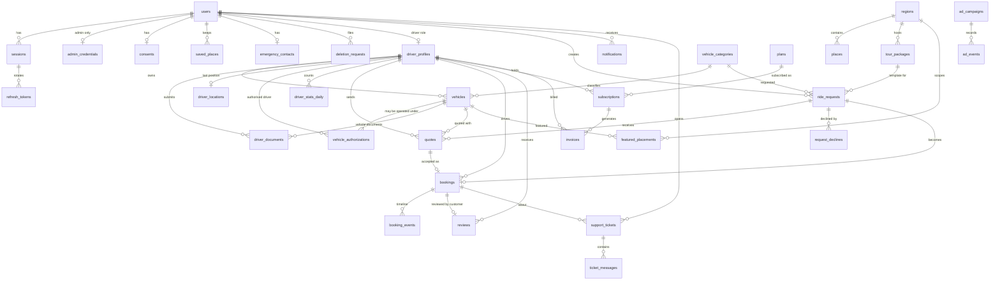

# Payana — Data Model (target)

*Version 1.0 · 2026-11-10*

> **Status: target model.** This document describes the schema the contract
> (`packages/contracts`) implies. Once migrations exist under
> `apps/api/src/**/migrations`, **the migrations are authoritative**; this
> document is then updated to match them, and any deliberate difference is
> noted in the table's "Notes".

## 1. Conventions

| Topic | Rule |
| --- | --- |
| Database | PostgreSQL 17 with extensions `postgis`, `pgcrypto` (UUID generation), `citext` |
| Keys | `id uuid primary key default gen_random_uuid()` unless stated |
| Time | `timestamptz`, UTC; `created_at` on every table, `updated_at` where rows change |
| Money | integer minor units in `*_minor` columns + `currency char(3)` where relevant (ADR-0017) |
| Geography | `geography(Point, 4326)`; GiST indexes; distances in metres |
| Enumerations | `text` + `CHECK` listing the contract's values (not native enums — easier forward migrations) |
| Deletion | Hard delete only where stated; otherwise status columns. Personal fields are nulled on erasure |
| Ownership | Each table belongs to one module; other modules never query it (ADR-0001) |
| PII class | **none** · **personal** (identifies or relates to a person) · **sensitive** (identity documents, precise location, credentials) |

## 2. Entity-relationship overview

Stand-alone tables (no foreign keys into the graph, or only loose ones):
`otp_challenges`, `platform_settings`, `audit_logs`, `outbox_events`,
`idempotency_keys`, `uploads`.

## 3. Module ownership

| Module | Tables |
| --- | --- |
| `identity` | `users`, `sessions`, `refresh_tokens`, `otp_challenges`, `admin_credentials`, `consents`, `saved_places`, `emergency_contacts`, `deletion_requests` |
| `catalog` | `regions`, `vehicle_categories`, `places` |
| `marketplace` | `driver_profiles`, `vehicles`, `vehicle_authorizations`, `driver_documents`, `driver_locations`, `driver_stats_daily` |
| `bookings` | `ride_requests`, `request_declines`, `quotes`, `bookings`, `booking_events` |
| `commerce` | `plans`, `subscriptions`, `invoices`, `featured_placements`, `tour_packages`, `ad_campaigns`, `ad_events` |
| `engagement` | `reviews`, `support_tickets`, `ticket_messages`, `notifications` |
| `platform` | `platform_settings`, `audit_logs`, `outbox_events`, `idempotency_keys`, `uploads` |

## 4. Identity

### `users` — every account · PII: personal

| Column | Type | Constraints / notes |
| --- | --- | --- |
| `id` | uuid | PK |
| `phone` | text | E.164; null for administrators; unique where not null |
| `email` | citext | null; unique where not null; unverified for phone accounts |
| `display_name` | text | null |
| `roles` | text[] | not null; subset of `customer`, `driver`, `admin`; default `{customer}` |
| `status` | text | `active` \| `suspended` \| `deletion_requested` \| `deleted` |
| `locale` | text | `en` \| `kn` \| `hi`; default `en` |
| `suspended_reason` | text | null |
| `last_seen_at` | timestamptz | null |
| `created_at`, `updated_at` | timestamptz | |
| `erased_at` | timestamptz | null; set by erasure, when `phone`, `email`, `display_name` are nulled |

Indexes: unique `(phone) WHERE phone IS NOT NULL`; unique `(email) WHERE email IS NOT NULL`; `(status)`; GIN `(roles)`; trigram on `phone`, `email`, `display_name` for admin search.
Retention: until erasure; row kept as an anonymous stub so foreign keys hold.

### `sessions` — one per signed-in device · PII: personal

| Column | Type | Notes |
| --- | --- | --- |
| `id` | uuid | PK; the JWT `sid` |
| `user_id` | uuid | FK `users` |
| `device_label` | text | null |
| `client_platform` | text | `web` \| `native` |
| `ip` | inet | of creation |
| `user_agent` | text | truncated to 300 chars |
| `created_at`, `last_used_at` | timestamptz | |
| `expires_at` | timestamptz | absolute lifetime |
| `revoked_at` | timestamptz | null |
| `revoked_reason` | text | `logout` \| `user_revoked` \| `reuse_detected` \| `suspended` \| `role_changed` \| `erased` |

Indexes: `(user_id, revoked_at)`; `(expires_at)`. Retention: 30 days after expiry/revocation.

### `refresh_tokens` — rotation chain · PII: sensitive (credential hash)

| Column | Type | Notes |
| --- | --- | --- |
| `id` | uuid | PK |
| `session_id` | uuid | FK `sessions` ON DELETE CASCADE |
| `token_hash` | bytea | HMAC-SHA-256 of the token; unique |
| `issued_at` | timestamptz | |
| `used_at` | timestamptz | null; set when rotated — presenting a used token = reuse |
| `expires_at` | timestamptz | |

Indexes: unique `(token_hash)`; `(session_id)`. Retention: with the session.

### `otp_challenges` · PII: personal (phone), sensitive (code hash)

| Column | Type | Notes |
| --- | --- | --- |
| `id` | uuid | PK; `challengeId` |
| `phone` | text | E.164 |
| `code_hash` | bytea | keyed hash |
| `intent` | text | `customer` \| `driver`; null |
| `attempts` | smallint | default 0 |
| `expires_at` | timestamptz | |
| `consumed_at` | timestamptz | null |
| `ip` | inet | |
| `created_at` | timestamptz | |

Indexes: `(phone, created_at DESC)`; `(expires_at)`. Retention: 24 h (purge job).

### `admin_credentials` · PII: sensitive

| Column | Type | Notes |
| --- | --- | --- |
| `user_id` | uuid | PK, FK `users` |
| `admin_role` | text | one of `AdminRole` |
| `password_hash` | text | Argon2id |
| `must_change_password` | boolean | default true (no operation consumes it yet — F-01 G-1) |
| `mfa_secret_enc` | bytea | null until enrolment; encrypted with a key from the secret store |
| `mfa_enabled_at` | timestamptz | null |
| `failed_attempts` | smallint | |
| `locked_until` | timestamptz | null |
| `last_login_at` | timestamptz | null |
| `created_by` | uuid | FK `users`; null for the seeded account |

### `consents` · PII: personal

| Column | Type | Notes |
| --- | --- | --- |
| `user_id` | uuid | PK, FK `users` ON DELETE CASCADE |
| `analytics`, `advertising`, `marketing_messages` | boolean | default false |
| `updated_at` | timestamptz | null until first change |

History of changes is evidenced in `audit_logs` (`consent.updated`). Deleted on erasure.

### `saved_places` · PII: sensitive (home/stay location)

| Column | Type | Notes |
| --- | --- | --- |
| `id` | uuid | PK |
| `user_id` | uuid | FK `users` ON DELETE CASCADE |
| `label` | text | ≤ 40 |
| `address` | text | null, ≤ 200 |
| `location` | geography(Point,4326) | |
| `kind` | text | `home` \| `stay` \| `work` \| `other` |
| `created_at` | timestamptz | |

Index: `(user_id)`. Constraint: ≤ `MAX_SAVED_PLACES` per user (enforced in the use case). Deleted on erasure.

### `emergency_contacts` · PII: personal (third party)

`user_id` PK/FK · `name` text · `phone` text (E.164) · `relationship` text null · `updated_at`. Deleted on erasure.

### `deletion_requests` · PII: personal

`id` · `user_id` FK · `reason` text null · `requested_at` · `scheduled_for` · `cancelled_at` null · `completed_at` null.
Index: unique `(user_id) WHERE cancelled_at IS NULL AND completed_at IS NULL`; `(scheduled_for) WHERE completed_at IS NULL`. `reason` nulled on completion.

## 5. Catalogue

### `regions` · PII: none

| Column | Type | Notes |
| --- | --- | --- |
| `id` | uuid | PK |
| `slug` | text | unique; immutable |
| `name`, `name_local`, `state`, `tagline` | text | `name_local`, `tagline` nullable |
| `center` | geography(Point,4326) | |
| `radius_km` | numeric(5,1) | 1–100 |
| `status` | text | `live` \| `coming_soon` \| `hidden` |
| `created_at`, `updated_at` | timestamptz | |

Indexes: unique `(slug)`; GiST `(center)`; `(status)`.

### `vehicle_categories` · PII: none

`id` · `code` text unique immutable · `name` · `description` null · `icon` text (`VehicleIcon`) · `seats` smallint · `luggage_capacity` smallint · `base_fare_minor`, `per_km_minor`, `min_per_km_minor`, `max_per_km_minor`, `per_hour_waiting_minor` integer · `currency` · `sort_order` smallint · `is_active` boolean · timestamps.
Check: `min_per_km_minor <= per_km_minor AND per_km_minor <= max_per_km_minor`.

### `places` — curated pickup / drop points · PII: none

Admin-curated reference data behind `GET /places` (`PlaceSuggestion`).

| Column | Type | Notes |
| --- | --- | --- |
| `id` | uuid | PK |
| `region_id` | uuid | FK `regions`; **nullable** — an endpoint outside every configured market |
| `region_slug` | text | not null; denormalised label returned as `PlaceSuggestion.regionSlug`. Equals the region's slug when `region_id` is set; otherwise a slug naming the out-of-market area the point lies in (for example an airport's city), used for an outstation endpoint |
| `label` | text | 1–80; shown to users |
| `address` | text | null |
| `location` | geography(Point,4326) | |
| `kind` | text | `transport` \| `beach` \| `temple` \| `town` \| `landmark` (`PlaceKind`) |
| `sort_order` | smallint | default 100 |
| `is_active` | boolean | default true |
| `created_at`, `updated_at` | timestamptz | |

Indexes: `(region_id, is_active, sort_order)`; GiST `(location)`; trigram or `lower(label)` index for `q`; unique `(region_slug, lower(label))`.
Notes: maintained by seed/migration at R1 — no admin operation exists in the contract (F-03 G-1). How `regionSlug` is produced for a place with no region is an implementation choice; the denormalised column above is one way to satisfy the non-null `PlaceSuggestion.regionSlug`.

## 6. Marketplace

### `driver_profiles` · PII: personal

| Column | Type | Notes |
| --- | --- | --- |
| `id` | uuid | PK; public `driverId` |
| `user_id` | uuid | FK `users`; unique |
| `partner_type` | text | `PartnerType` |
| `display_name` | text | |
| `bio` | text | null |
| `photo_key` | text | null; storage key |
| `languages` | text[] | |
| `years_experience` | smallint | null |
| `service_area_slugs` | text[] | region slugs |
| `verification_status` | text | `VerificationStatus` |
| `listing_status` | text | `ListingStatus` |
| `listed` | boolean | maintained flag = passes the gate of F-05 BR-05; what search filters on |
| `availability` | text | `AvailabilityStatus`; default `offline` |
| `operating_hours` | jsonb | `OperatingHours` or null |
| `active_vehicle_id` | uuid | FK `vehicles`; null |
| `rating_average` | numeric(2,1) | null |
| `rating_count`, `completed_trips` | integer | default 0 |
| `submitted_at`, `verified_at` | timestamptz | null |
| timestamps | | |

Indexes: unique `(user_id)`; GIN `(service_area_slugs)`; `(verification_status, submitted_at)`; partial `(id) WHERE listed`.

### `vehicles` · PII: personal (registration number)

`id` · `owner_profile_id` FK `driver_profiles` · `category_id` FK · `make`, `model` text · `year` smallint null · `color` text null · `registration_number` text (normalised) · `seats`, `luggage_capacity` smallint · `has_ac` boolean · `photo_keys` text[] · `base_fare_minor`, `per_km_minor`, `per_hour_waiting_minor`, `full_day_minor` integer null · `verification_status` · `listing_status` · timestamps · `deleted_at` null.
Indexes: unique `(registration_number) WHERE deleted_at IS NULL`; `(owner_profile_id)`; `(category_id, listing_status)`.

### `vehicle_authorizations` · PII: personal (phone)

`id` · `vehicle_id` FK · `owner_profile_id` FK · `driver_profile_id` FK null (until the phone has a profile) · `driver_phone` text · `status` (`AuthorizationStatus`) · `valid_until` date null · `created_at` · `accepted_at`, `revoked_at` null · `revoked_by` uuid null.
Indexes: unique `(vehicle_id, driver_phone) WHERE status IN ('invited','active')`; `(driver_profile_id, status)`; `(driver_phone) WHERE status = 'invited'`; `(valid_until) WHERE status = 'active'`.

### `driver_documents` · PII: **sensitive**

| Column | Type | Notes |
| --- | --- | --- |
| `id` | uuid | PK |
| `driver_profile_id` | uuid | FK |
| `vehicle_id` | uuid | FK; null for person documents |
| `type` | text | `DocumentType` |
| `document_number` | text | null; full number — admin-visible only; encrypt at the application layer if advised (D-03) |
| `number_last4` | text | for `numberMasked` |
| `expires_on` | date | null |
| `file_key` | text | storage key (private bucket) |
| `content_type` | text | |
| `status` | text | `DocumentStatus` |
| `rejection_reason` | text | `DocumentRejectionReason`; null |
| `reviewer_note` | text | null |
| `submitted_at`, `reviewed_at` | timestamptz | |
| `reviewed_by` | uuid | FK `users`; null |
| `superseded_at` | timestamptz | null; set when a newer document of the same type/vehicle is submitted |

Indexes: `(driver_profile_id, type, vehicle_id) WHERE superseded_at IS NULL`; `(status)`; `(expires_on) WHERE status = 'approved' AND superseded_at IS NULL`.
Retention: 180 days after profile closure or supersession ◊ (D-13), then row and object deleted.

### `driver_locations` — last position only · PII: **sensitive**

`driver_profile_id` PK/FK · `location` geography(Point,4326) · `accuracy_m` real null · `recorded_at` timestamptz (device) · `received_at` timestamptz (server).
Index: GiST `(location)`; `(recorded_at)`.
Notes: upsert on every ping — **no history** (NFR-PRIV-002). Deleted when the profile closes.

### `driver_stats_daily` — counters · PII: none

`driver_profile_id` FK · `day` date · `profile_views`, `requests_offered`, `quotes_sent` integer. PK `(driver_profile_id, day)`. Supports `DriverMetrics`. Retention 13 months.
Notes: implied by `DriverMetrics.profileViews`; not named in the contract.

## 7. Requests, quotes, bookings

### `ride_requests` · PII: personal (trip locations, notes)

| Column | Type | Notes |
| --- | --- | --- |
| `id` | uuid | PK |
| `customer_id` | uuid | FK `users` |
| `status` | text | `RideRequestStatus` |
| `trip_type` | text | `TripType` |
| `pickup_label`, `pickup_address` | text | address nullable |
| `pickup_location` | geography(Point,4326) | |
| `pickup_region_id` | uuid | FK `regions` |
| `drop_label`, `drop_address` | text | null |
| `drop_location` | geography(Point,4326) | null |
| `drop_region_slug` | text | null |
| `scheduled_at`, `return_at` | timestamptz | null |
| `category_id` | uuid | FK |
| `passengers`, `luggage` | smallint | |
| `notes` | text | null |
| `package_id` | uuid | FK `tour_packages`; null |
| `package_title` | text | snapshot; null |
| `target_driver_id` | uuid | FK `driver_profiles`; null |
| `estimate` | jsonb | `FareEstimate`; null |
| `drivers_notified` | integer | |
| `booking_id` | uuid | null |
| `created_at`, `expires_at` | timestamptz | |
| `closed_at` | timestamptz | null |

Indexes: `(customer_id, created_at DESC)`; `(status, expires_at)`; partial `(pickup_region_id, category_id) WHERE status = 'open'`; GiST `(pickup_location)`; `(target_driver_id) WHERE status = 'open'`.
Retention: 8 years with `notes`, labels and addresses nulled on customer erasure.

### `request_declines` · PII: none

PK `(request_id, driver_profile_id)` · `created_at`. Retention: with the request, purged 30 days after it closes.

### `quotes` · PII: none

`id` · `request_id` FK · `driver_profile_id` FK · `vehicle_id` FK · `status` (`QuoteStatus`) · `fare_minor` integer · `currency` · `inclusions`, `exclusions` text[] · `pickup_note` text null · `eta_minutes` smallint null · `valid_until` timestamptz · `created_at` · `closed_at` null.
Indexes: unique `(request_id, driver_profile_id) WHERE status = 'active'`; `(request_id, status)`; `(driver_profile_id, created_at DESC)`; `(status, valid_until)`.

### `bookings` · PII: personal

| Column | Type | Notes |
| --- | --- | --- |
| `id` | uuid | PK |
| `code` | text | unique; `PY-XXXXX` |
| `request_id`, `quote_id` | uuid | FK; each unique |
| `customer_id` | uuid | FK `users` |
| `driver_profile_id` | uuid | FK |
| `vehicle_id` | uuid | FK |
| `status` | text | `BookingStatus` |
| `trip_type` | text | |
| pickup / drop snapshot | as in `ride_requests` | copied, immutable |
| `scheduled_at` | timestamptz | not null |
| `return_at` | timestamptz | null |
| `passengers`, `luggage` | smallint | |
| `notes`, `package_title`, `pickup_note` | text | null |
| `quoted_minor`, `booking_fee_minor`, `total_minor` | integer | frozen at acceptance |
| `currency` | char(3) | |
| `inclusions`, `exclusions` | text[] | |
| `cancellation_policy` | jsonb | frozen `CancellationPolicy` |
| `cancellation_reason` | text | `CancellationReason`; null |
| `cancellation_note` | text | null |
| `cancellation_fee_minor` | integer | null |
| `status_before_dispute` | text | null |
| `version` | integer | optimistic lock |
| `created_at`, `completed_at` | timestamptz | |

Indexes: unique `(code)`, `(request_id)`, `(quote_id)`; `(customer_id, scheduled_at)`; `(driver_profile_id, scheduled_at)`; `(status)`; `(created_at)`.
Retention: 8 years; free-text and address fields nulled on erasure of the customer.

### `booking_events` — append-only timeline · PII: none

`id` · `booking_id` FK · `status` · `actor` (`customer` \| `driver` \| `admin` \| `system`) · `actor_id` uuid null · `note` text null · `at` timestamptz.
Index: `(booking_id, at)`. No `UPDATE`/`DELETE` by the application role.

## 8. Commerce

### `plans` · PII: none

`id` · `code` unique immutable · `name` · `description` · `price_minor` · `currency` · `billing_period` (`BillingPeriod`) · `entitlements` jsonb (`PlanEntitlements`) · `highlights` text[] · `is_recommended`, `is_active` boolean · `sort_order` · timestamps.

### `subscriptions` · PII: none

`id` · `driver_profile_id` FK · `plan_id` FK · `status` (`SubscriptionStatus`) · `price_minor_snapshot` · `entitlements_snapshot` jsonb · `current_period_start`, `current_period_end` timestamptz · `auto_renew` boolean · `created_at` · `cancelled_at`, `ended_at` null.
Indexes: unique `(driver_profile_id) WHERE ended_at IS NULL`; `(status, current_period_end)`.

### `invoices` · PII: personal (links a person to a payment)

`id` · `number` text unique (`INV-YYYY-NNNNNN`) · `driver_profile_id` FK · `subscription_id` FK null · `featured_placement_id` FK null · `description` · `amount_minor` · `currency` · `status` (`InvoiceStatus`) · `provider` (`PaymentProvider`) · `provider_order_id`, `provider_payment_id` text null · `issued_at` · `paid_at` null.
Indexes: unique `(number)`; `(driver_profile_id, issued_at DESC)`; unique `(provider, provider_order_id) WHERE provider_order_id IS NOT NULL`.
Retention: 8 years (financial record). Tax fields absent (D-10).

### `featured_placements` · PII: none

`id` · `driver_profile_id` FK · `vehicle_id` FK · `region_id` FK · `starts_on`, `ends_on` date · `status` (`scheduled` \| `active` \| `ended` \| `cancelled`) · `from_plan_allowance` boolean · `invoice_id` FK null · `created_at`.
Constraint: exclusion on `(vehicle_id, region_id, daterange(starts_on, ends_on, '[]'))` for non-cancelled rows. Index: `(region_id, starts_on, ends_on) WHERE status <> 'cancelled'`.

### `tour_packages` · PII: none

`id` · `slug` unique immutable · `title` · `summary` · `region_id` FK · `artwork` (`PackageArtwork`) · `duration_hours` numeric(4,1) · `distance_km` numeric(5,1) · `stops` jsonb (`PackageStop[]`) · `highlights` text[] · `price_from` jsonb · `best_time` text null · `is_active` · `sort_order` · timestamps.
Index: `(region_id, is_active, sort_order)`.

### `ad_campaigns` · PII: personal (advertiser contact — business contact)

`id` · `advertiser_name` · `advertiser_contact` null · `title` · `body` · `image_url` null · `cta_label` · `cta_url` · `placements` text[] · `region_slugs` text[] · `starts_on`, `ends_on` date · `status` (`AdCampaignStatus`) · `weight` smallint 1–10 · `impressions`, `clicks` bigint default 0 · `created_by` FK `users` · timestamps.
Indexes: `(status, starts_on, ends_on)`; GIN `(placements)`; GIN `(region_slugs)`.

### `ad_events` — append-only · PII: none (salted address hash only, short-lived)

`id` bigint identity · `campaign_id` FK · `kind` (`impression` \| `click`) · `placement` · `region_slug` null · `ip_hash` bytea null (nulled after 24 h) · `occurred_at`.
Index: `(campaign_id, occurred_at)`; monthly partitions ◊. Retention: 90 days.

## 9. Engagement

### `reviews` · PII: personal (comment text)

`id` · `booking_id` FK unique · `driver_profile_id` FK · `customer_id` FK `users` · `rating` smallint CHECK 1–5 · `comment` text null · `author_name` text (snapshot "Anita R.") · `trip_type` text · `reply_text` text null · `reply_at` null · `status` (`ReviewStatus`) · `moderated_by` uuid null · `moderation_reason` text null · `created_at`.
Index: `(driver_profile_id, status, created_at DESC)`. On customer erasure: `customer_id` kept (stub user), `author_name` → "Deleted user".

### `support_tickets` · PII: personal

`id` · `reference` text unique (`T-NNNNNN`) · `user_id` FK · `category` (`TicketCategory`) · `status` (`TicketStatus`) · `priority` (`TicketPriority`) · `subject` · `booking_id` FK null · `assigned_to` uuid null (reserved — no operation yet) · `created_at`, `updated_at`.
Indexes: `(user_id, updated_at DESC)`; `(status, priority, updated_at)`; `(booking_id)`.
Retention: 3 years after closure ◊.

### `ticket_messages` · PII: personal (free text)

`id` · `ticket_id` FK ON DELETE CASCADE · `author` (`user` \| `support`) · `author_id` FK `users` · `body` text · `created_at`. Index: `(ticket_id, created_at)`.

### `notifications` · PII: personal

`id` · `user_id` FK ON DELETE CASCADE · `type` (`NotificationType`) · `title` · `body` · `link` text null · `read_at` null · `created_at` · `source_event_id` uuid (idempotency).
Indexes: `(user_id, created_at DESC)`; partial `(user_id) WHERE read_at IS NULL`; unique `(source_event_id, user_id)`.
Retention: 180 days.

## 10. Platform

### `platform_settings` · PII: none

`key` text PK (`analytics`, `features`, `support`, `bookingFee`, `defaultRegionSlug`) · `value` jsonb · `updated_by` uuid null · `updated_at`.
Notes: values are public or operational configuration — never secrets.

### `audit_logs` — append-only · PII: personal (actor, IP)

| Column | Type | Notes |
| --- | --- | --- |
| `id` | uuid | PK |
| `at` | timestamptz | |
| `actor_id` | uuid | null for `system` |
| `actor_label` | text | email of an admin, "user", or `system` |
| `action` | text | dotted verb from a closed catalogue |
| `target_type`, `target_id` | text | null |
| `metadata` | jsonb | allow-listed keys; never secrets, OTPs, tokens, document numbers |
| `ip` | inet | null |
| `request_id` | text | null |

Indexes: `(at DESC)`; `(action, at DESC)`; `(actor_id, at DESC)`; `(target_type, target_id, at DESC)`.
Privileges: application role has `INSERT`, `SELECT` only (NFR-SEC-010). Retention: 2 years, then archived or deleted by a privileged maintenance role.

### `outbox_events` · PII: none (IDs only)

`id` uuid PK · `type` text · `aggregate_type`, `aggregate_id` text · `payload` jsonb (identifiers, not personal data) · `occurred_at` · `available_at` · `attempts` smallint · `last_error` text null · `processed_at` null · `parked_at` null.
Indexes: `(available_at) WHERE processed_at IS NULL AND parked_at IS NULL`; `(aggregate_type, aggregate_id, occurred_at)`.
Retention: 14 days after processing.

### `idempotency_keys` · PII: none

`user_id` uuid · `route` text (method + template) · `key` text · `request_hash` bytea · `status_code` smallint null · `response_body` jsonb null · `created_at` · `expires_at`. PK `(user_id, route, key)`. Index `(expires_at)`. Retention: 24 h.
Notes: `response_body` may contain the caller's own data; it is returned only to the same user.

### `uploads` — presign bookkeeping · PII: none

`file_key` text PK · `user_id` FK · `purpose` (`UploadPurpose`) · `content_type` · `max_bytes` integer · `created_at` · `expires_at` · `attached_at` null.
Index: `(expires_at) WHERE attached_at IS NULL` (orphan purge).

## 11. Geospatial notes

| Query | Shape |
| --- | --- |
| Drivers near a point | `ST_DWithin(driver_locations.location, :point::geography, :metres)` + `ST_Distance` + `ST_Azimuth`, joined to `driver_profiles WHERE listed` (F-06 §6) |
| Region of a point | nearest `regions.center` with `ST_DWithin(center, :point, radius_km * 1000)` |
| Immediate fan-out | same as search with `availability = 'available'` and a freshness bound |
| Duplicate-request guard | `ST_DWithin(pickup_location, :point, 200)` on the customer's open requests |

All spatial columns are `geography`, so distances are geodesic metres and no
SRID conversion is needed. Every spatial predicate has a supporting GiST
index; NFR-PERF-002 is asserted with `EXPLAIN (ANALYZE)` in an integration
test.

## 12. Retention summary (NFR-PRIV-003)

| Data | Retention ◊ | Mechanism |
| --- | --- | --- |
| OTP challenges, idempotency keys | 24 h | `retention-purge` |
| Sessions and refresh tokens | 30 days after end | `retention-purge` |
| Processed outbox events | 14 days | `retention-purge` |
| `ad_events` | 90 days (address hash 24 h) | partition drop / purge |
| Notifications | 180 days | `retention-purge` |
| Driver documents (rows + files) | 180 days after closure or supersession | `retention-purge` + storage lifecycle |
| Driver location | until overwritten or profile closed | upsert / erasure |
| Support tickets | 3 years after closure | `retention-purge` |
| Audit logs | 2 years | maintenance role |
| Bookings, booking events, invoices | 8 years, anonymised on erasure | erasure job |
| Account personal fields | until erasure (grace `ACCOUNT_DELETION_GRACE_DAYS`) | `account-erasure` |

Periods are defaults pending legal review (D-03, D-13).

## 13. Gaps and open points

| # | Item |
| --- | --- |
| DM-1 | `places.region_id` is nullable but `PlaceSuggestion.regionSlug` is a required string — the model keeps a denormalised `region_slug`; the implementation may instead create `hidden` regions for out-of-market endpoints. |
| DM-2 | `driver_stats_daily` and `uploads` are not named by the contract; they are implied by `DriverMetrics.profileViews` and by presigned uploads. |
| DM-3 | No tables for coupons, refunds, payment reconciliation, notification templates, push tokens or delivery receipts — the corresponding requirements are P2 and have no contract types. |
| DM-4 | No location history, by decision (NFR-PRIV-002). |
| DM-5 | `driver_documents.document_number` is stored in clear at the database level; column-level encryption is a decision for the security review (D-03). |
| DM-6 | Service areas are a `text[]` of slugs for simplicity; a join table to `regions` would add referential integrity at the cost of a join in search. |
