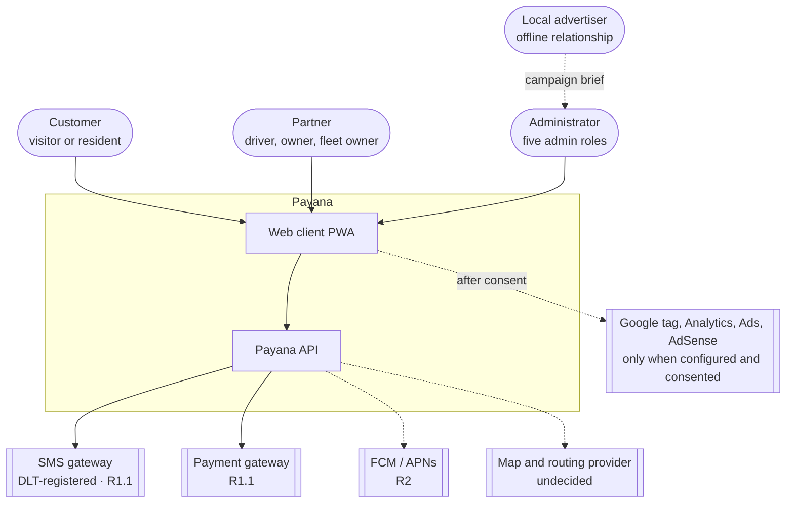
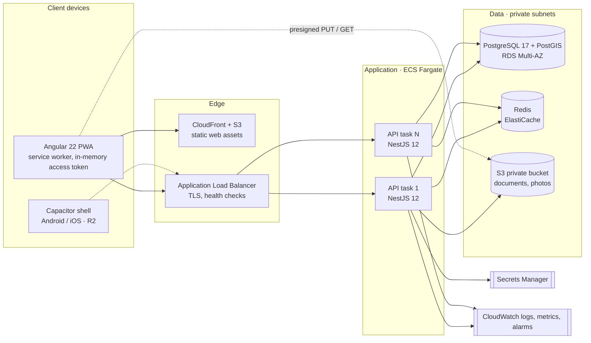
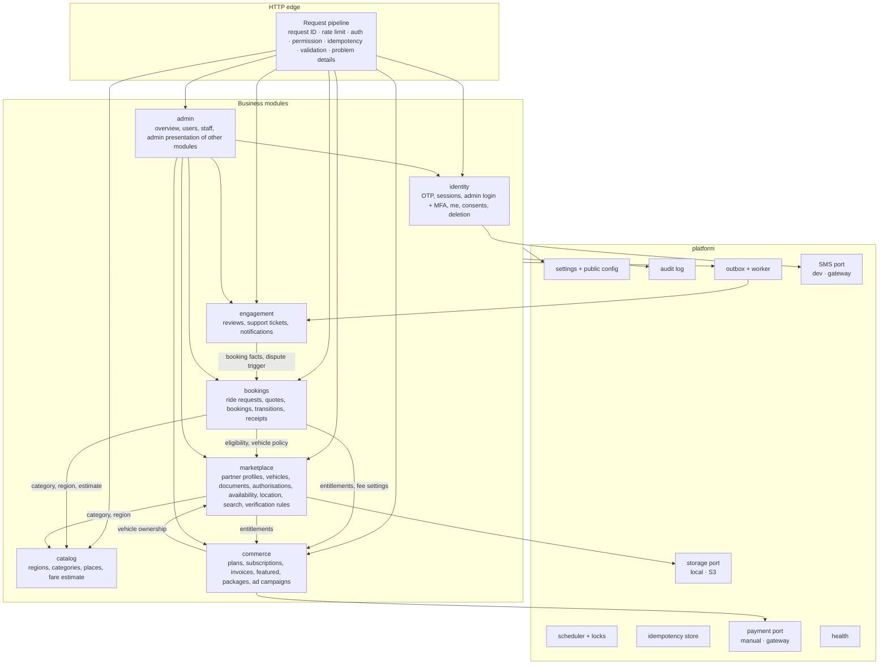
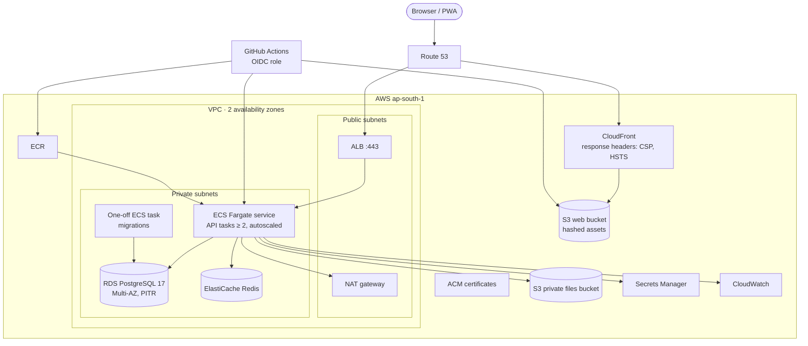
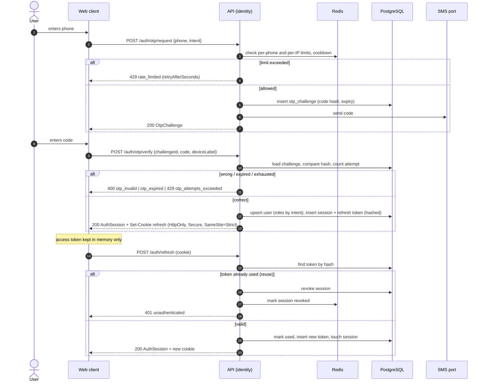
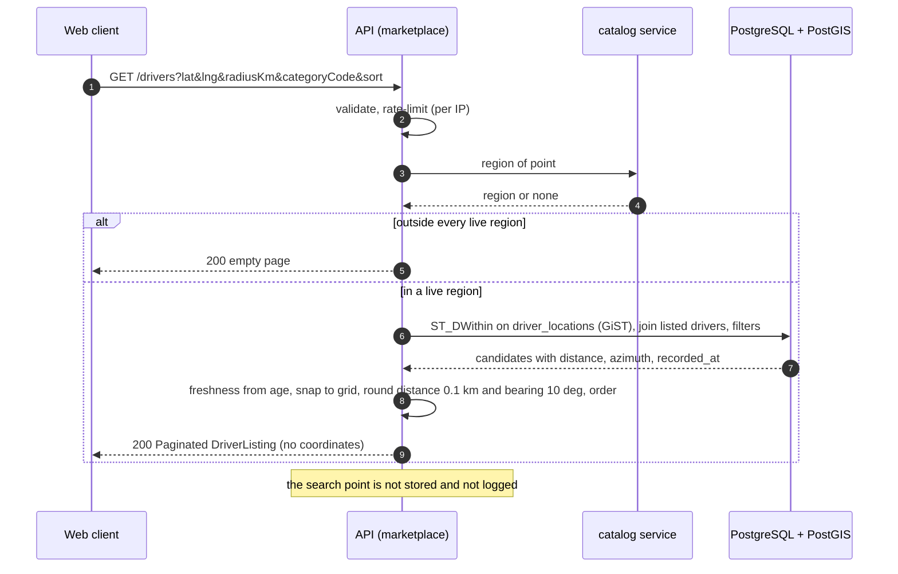
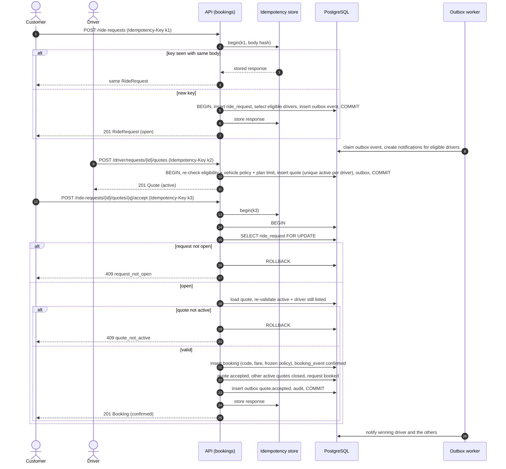
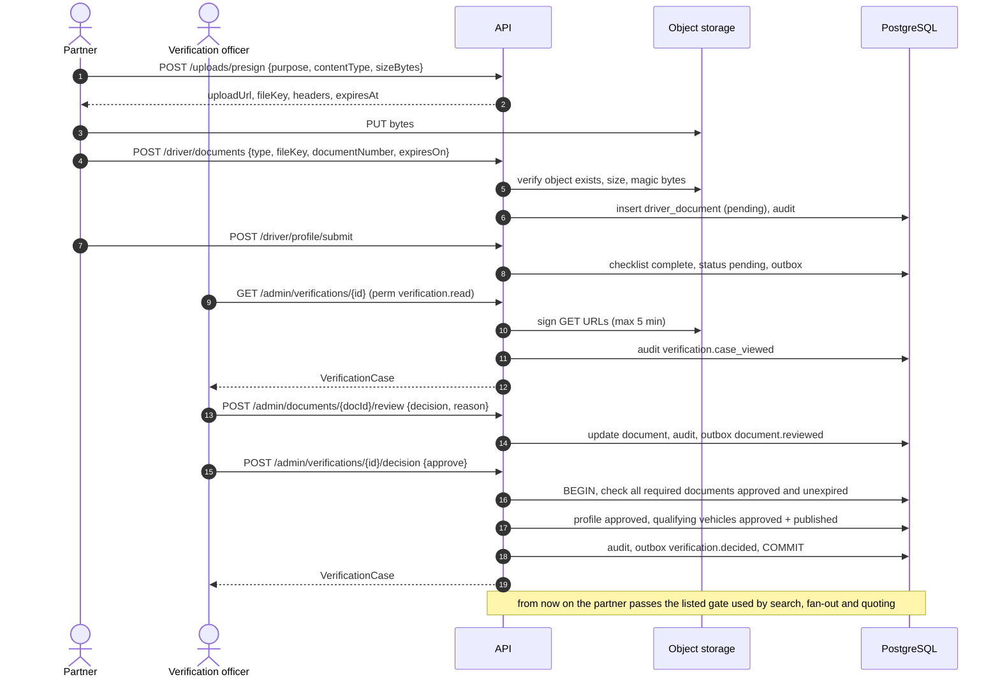
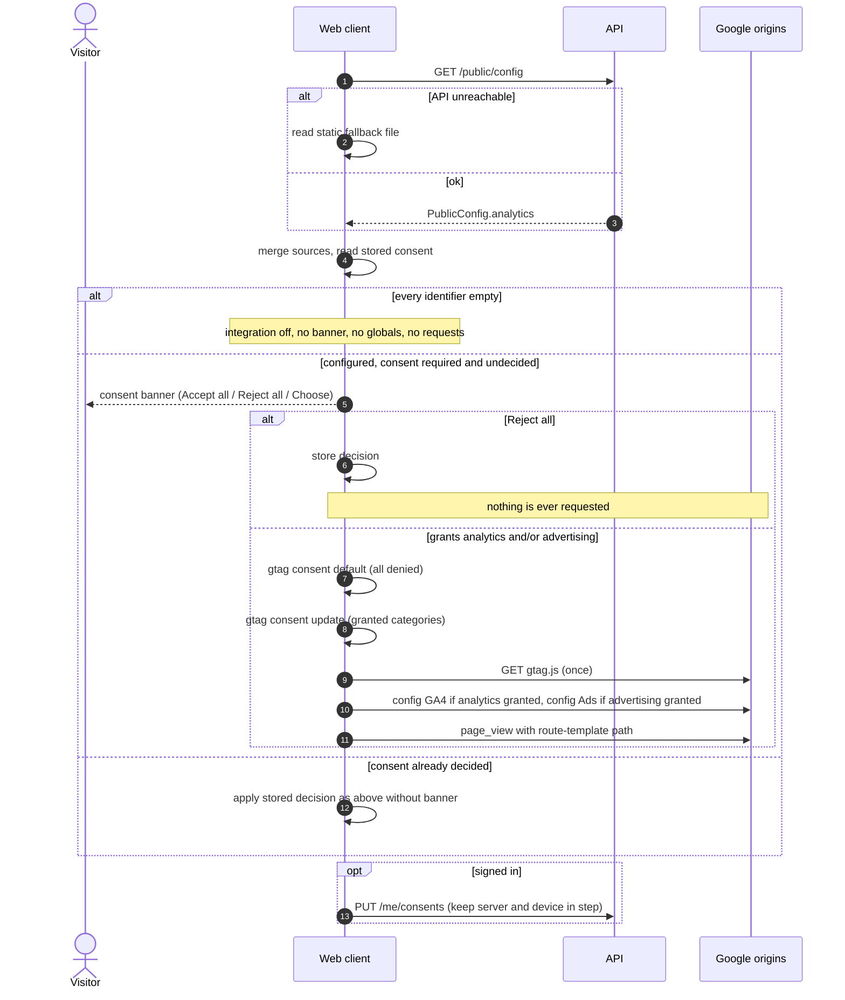

# Payana — System Design

*Version 1.0 · 2026-11-10 · decisions are recorded in `adr/`*

This document describes the target architecture of Release 1. Where the code
and this document disagree after implementation, the difference is a defect
in one of them and is resolved explicitly — not left standing.

## 1. Architectural drivers

| Driver | Consequence |
| --- | --- |
| Small team, one launch town, unknown demand | Modular monolith; managed services; no premature distribution (ADR-0001) |
| Expansion to more towns by configuration | Region, category, place, plan and fee are data (F-03) |
| Trust and privacy are the product | Server-side authorisation everywhere; location and phone disclosure rules in one place; consent-gated tags |
| Patchy mobile networks | PWA shell, small bundles, idempotent writes, polling tolerant of loss |
| Web now, native later | Typed shared contracts; platform adapters; token transport that works for both |
| External vendors undecided (SMS, payments, maps) | Ports with development adapters; vendors are swappable |

## 2. System context



Solid lines exist in R1 (SMS and payments through development adapters).
Dashed lines are later releases or conditional.

## 3. Containers



| Container | Technology | Responsibility | State |
| --- | --- | --- | --- |
| Web client | Angular 22, standalone components, signals, service worker | All three audiences' UI; lazy areas `home, explore, auth, booking, account, packages, partner, admin, legal` | Access token in memory; consent choice and drafts on device; catalogue in SW cache |
| API | NestJS 12 on Node 24, REST under `/api/v1` | All business rules, authorisation, jobs, outbox worker | Stateless |
| PostgreSQL + PostGIS | RDS | System of record; geospatial queries | Durable |
| Redis | ElastiCache | Rate limits, lockouts, job locks, short caches, in-flight idempotency markers, session-revocation cache | Ephemeral; rebuildable |
| Object storage | S3 (local disk in development) | Documents, vehicle and profile photos | Durable, private |
| Shared contracts | `packages/contracts` (TypeScript) | Types, enums, constants, route map compiled into web and API | Build-time |

## 4. API components (modular monolith)



### 4.1 Layers inside a module

```
modules/<name>/
  domain/          entities, value objects, policies, domain events, repository + gateway ports
  application/     use cases (one class per operation), transactions, authorisation checks on resources
  infrastructure/  TypeORM entities + repositories, Redis, adapters implementing ports
  presentation/    controllers, request DTOs with validation, response mappers
  <name>.module.ts exports ONLY its public application services
```

Dependencies point inward: `presentation → application → domain ←
infrastructure`. Frameworks appear only in `presentation` and
`infrastructure`.

### 4.2 Module boundary rules

| Rule | Enforcement |
| --- | --- |
| A module never reads or joins another module's tables | Import-boundary lint; repository classes are not exported |
| Cross-module calls use exported application services (synchronous, in-process) | Module `exports` |
| Cross-module reactions use domain events through the outbox (asynchronous) | Outbox handlers |
| Shared kernel is limited to `packages/contracts` types and `platform` services | Review |
| Foreign keys across module boundaries are allowed for integrity but are never navigated in code | Review |

Policies that several modules need live where the data lives and are exported
as services: *listed driver* and *may operate vehicle* (marketplace),
*entitlements* (commerce), *region of a point* (catalog).

### 4.3 Dependency note

`marketplace ⇄ commerce` is a cycle at module level (entitlements ↔ vehicle
ownership). It is broken by ports: commerce defines a `VehicleOwnershipPort`
that marketplace implements, and marketplace depends on commerce's
`EntitlementService`. No cyclic provider injection is permitted.

## 5. Deployment



- Web and API are served from sibling hostnames of one registrable domain
  (for example `app.` and `api.`) so the refresh cookie is first-party and
  `SameSite=Strict` works; alternatively CloudFront routes `/api/*` to the
  ALB so both share an origin. The second option is preferred because it
  removes CORS entirely; either is supported by configuration.
- Environments: `staging` and `production`, identical modules, separate
  accounts or at least separate VPCs and state.
- Local development: Docker Compose (PostgreSQL + PostGIS on host port 5439,
  Redis on 6380, optional MinIO), API and web run on the host; the Angular
  dev server proxies `/api` to the API so cookies are same-origin.

## 6. Key sequences

### 6.1 OTP sign-in with refresh rotation



### 6.2 Nearby search



### 6.3 Request → quote → accept (transactional lock + idempotency)



A concurrent second accept blocks on the row lock, then sees `booked` and
returns `409 request_not_open`. A network retry with the same key returns the
stored booking.

### 6.4 Document verification



### 6.5 Analytics consent loading



## 7. Events and the outbox

- **Why**: notifications, counters and other reactions must not make a
  booking fail, and must not be lost if the process dies after commit.
- **Mechanism**: the use case inserts an `outbox_events` row in the same
  transaction as its state change. A worker in each API task claims rows
  with `FOR UPDATE SKIP LOCKED`, dispatches to in-process handlers, marks
  them processed, retries failures with back-off and parks poison events
  (NFR-REL-005).
- **Guarantee**: at-least-once, per-aggregate ordering by `occurred_at`;
  handlers are idempotent on `(event_id, handler)`.
- **Event catalogue** (type · aggregate): `ride_request.created|expired|cancelled`,
  `quote.submitted|withdrawn|accepted`, `booking.transitioned|cancelled|dispute_opened|dispute_resolved`,
  `document.reviewed|expiring|expired`, `verification.decided`,
  `authorization.created|accepted|revoked`, `subscription.changed`,
  `review.submitted`, `ticket.updated|message_added`, `account.suspended|deletion_scheduled|erased`.
- **Evolution**: when a module is extracted, its handlers move behind
  SNS/SQS; the outbox table becomes the relay source. Producers do not change.

## 8. Caching

| What | Where | TTL | Invalidation |
| --- | --- | --- | --- |
| Catalogue (regions, categories, places), public config | Redis + HTTP `ETag`/`Cache-Control`; service worker | 60 s server; SW per F-17 | On admin write |
| Entitlements per partner | Redis | 60 s | On subscription change |
| Eligible ad campaigns per placement + region | Redis | 60 s | On campaign write |
| Session-revocation flags | Redis | ≤ access-token lifetime | On logout / reuse / suspension |
| Admin overview | Redis | 60 s | Time only |
| Search results | Not cached (position- and time-dependent) | — | — |
| Authenticated responses | Never cached by intermediaries (`no-store`) | — | — |

Redis is never the only copy of anything that matters (ADR-0013).

## 9. Cross-cutting design

| Concern | Design |
| --- | --- |
| Authentication | ADR-0003: short JWT access token in memory + rotating opaque refresh token (HttpOnly cookie on web, secure store on native) |
| Authorisation | Declarative metadata on every handler (`public` / `user` / role / permission), enforced by a global guard; resource ownership checked in use cases; default deny |
| Validation | DTO classes with a global allow-list validation pipe; shared constants from `@payana/contracts` |
| Errors | One exception filter → `ProblemDetails` with `ErrorCode` |
| Idempotency | Interceptor on `(idem)` routes backed by `idempotency_keys` + Redis in-flight marker |
| Transactions | Unit of work opened by the use case; repositories take the transactional manager |
| Audit | `AuditService.record()` inside the transaction; append-only table |
| Configuration | Validated schema at start-up; secrets by reference |
| Time | UTC in storage and on the wire; `Asia/Kolkata` for business-day rules and display |
| Money | Integer minor units + currency (ADR-0017) |
| Geospatial | `geography(Point, 4326)` columns, GiST indexes, metres for distances |
| Realtime | Polling with `ETag` (ADR-0012) |
| Observability | JSON logs with request ID; RED metrics per route template; OpenTelemetry spans (P1) |

## 10. Web client architecture

```
apps/web/src/app/
  core/
    api/        typed API client built on ApiRoutes; interceptors (auth, idempotency, problem details)
    auth/       session store (signals), guards, refresh single-flight
    config/     PublicConfig loader + static fallback
    analytics/  AnalyticsPort, gtag adapter, consent store
    platform/   Geolocation, Storage, Network, Share, Camera, Push ports + web adapters
  ui/           design-system components, illustrations, motion directives (no feature knowledge)
  features/
    home/ explore/ auth/ booking/ account/ packages/ partner/ admin/ legal/
                each lazy-loaded: routes, pages, a small signal store, feature services
  styles/       tokens, base, utilities
```

- **State**: signals for local and derived state; one small injectable store
  per feature for server state and polling; RxJS at the HTTP/stream edges.
  No global store library (ADR-0005).
- **Routing**: lazy feature routes; functional guards for sign-in, role and
  permission (courtesy only — the API enforces).
- **Rendering**: client-side; no SSR at launch (ADR-0006).
- **Dependency rule**: `features → core, ui`; `ui → nothing app-specific`;
  `core → @payana/contracts`. Features do not import each other.

## 11. Extraction path to services

The monolith is split only when a measured need appears. The order below
follows coupling, not ambition.

| Step | Candidate | Trigger | What changes |
| --- | --- | --- | --- |
| 1 | **Worker process** (outbox handlers + scheduled jobs) | Jobs or fan-out compete with request latency | Same codebase, second ECS service with HTTP disabled; no contract change |
| 2 | **Notifications** (engagement handlers + channel adapters) | Push/SMS volume, provider rate limits | Outbox relay publishes to SNS/SQS; handlers consume there |
| 3 | **Discovery read model** | Search load dominates the primary database | Read replica or dedicated PostGIS store fed by events; `marketplace` search port gets a new adapter |
| 4 | **Commerce / payments** | Gateway webhooks, reconciliation, compliance isolation | Module becomes a service behind its existing service interface |
| 5 | **Identity** | Multiple client products or SSO | Token issuance separated; guards verify JWTs as today |

What makes each step cheap is already required in R1: no cross-module table
access, calls through exported interfaces, events through the outbox, and
contracts shared as a package.

## 12. Risks and open design questions

| # | Item | Mitigation / owner |
| --- | --- | --- |
| R-1 | Driver positions go stale because a PWA cannot report in the background | Freshness model; honest UI; native app in R2 (ADR-0007) |
| R-2 | Polling load grows with open requests | `ETag`/304, visibility-aware intervals, back-off; SSE in R2 (ADR-0012) |
| R-3 | Straight-line estimates mislead on ghat and estuary roads | Wide, labelled ranges; routing provider decision D-05 |
| R-4 | In-process jobs on N tasks | Distributed locks now; worker extraction step 1 |
| R-5 | Marketplace ⇄ commerce coupling | Ports as in §4.3; revisit at extraction step 4 |
| R-6 | Versions newer than the team's prior experience (NestJS 12, TypeORM 1.x, Angular 22, TypeScript 6) | Pin exact versions; rely on type-checking and integration tests; record deviations in ADRs |
