# Payana — Deployment and Release Plan

*Version 1.0 · 2026-11-10*

> **Where things stand.** Release 1 is built and tested on development
> adapters on a developer machine and in CI. **No cloud environment exists
> yet**: the Terraform under `infra/terraform` is definition only until an AWS
> account, domain and credentials are provided. Nothing in this plan should
> be read as "deployed". The blockers between R1 and real customers are in §8.

## 1. Environments

| Environment | Purpose | Infrastructure | Data | Adapters |
| --- | --- | --- | --- | --- |
| **Local** | Development, all automated test levels | Docker Compose: PostgreSQL 17 + PostGIS (host port 5439), Redis (6380), optional MinIO; API and web on the host | Seed + synthetic | SMS dev, payments manual, storage local disk |
| **CI** | Merge gates | GitHub Actions runners with service containers | Fresh per run | Same as local |
| **Staging** | Release candidate verification, smoke e2e, load, DAST | AWS `ap-south-1`, same Terraform modules as production at smaller size | Synthetic only | SMS sandbox/dev route, payment sandbox, S3 |
| **Production** | Customers | AWS `ap-south-1`: ECS Fargate + ALB, RDS Multi-AZ, ElastiCache, S3, CloudFront | Real | Real adapters only — start-up refuses development adapters |

Configuration differs only by environment variables and secrets; the build
artefacts (API image, web bundle) are identical across staging and
production.

## 2. Branching and versioning

- Trunk-based: short-lived branches → pull request → `main`.
- Every merge to `main` produces a candidate: API container image tagged
  with the commit SHA; web bundle with hashed assets.
- Releases are tagged `vMAJOR.MINOR.PATCH`. API contract version is the URL
  prefix (`/api/v1`); `@payana/contracts` carries its own semver.
- Database migrations are numbered by timestamp and travel with the commit.

## 3. CI/CD pipeline

```mermaid
flowchart LR
    subgraph gates [PR gates, all required]
        c[contracts build]
        a[API lint, types, unit,<br/>integration with PostGIS and Redis,<br/>OpenAPI drift]
        w[Web lint, types, unit,<br/>build and budgets, palette checks]
        e[E2E smoke and axe]
        s[Dependency audit, secret scan,<br/>terraform fmt and validate]
    end
    pr[Pull request] --> gates
    gates --> merge[Merge to main]
    merge --> build[Build API image + web bundle<br/>scan image, push to ECR]
    build --> stg_migrate[Staging: run migrations<br/>one-off task]
    stg_migrate --> stg_deploy[Staging: rolling deploy API,<br/>sync web to S3, invalidate CDN]
    stg_deploy --> stg_verify[Staging: smoke e2e,<br/>health, error-rate watch]
    stg_verify --> approve{Manual approval}
    approve --> prod_backup[Production: snapshot marker,<br/>confirm PITR]
    prod_backup --> prod_migrate[Production: run migrations]
    prod_migrate --> prod_deploy[Production: rolling deploy,<br/>web sync, CDN invalidation]
    prod_deploy --> prod_verify[Post-deploy checks<br/>30 min watch]
```

| Stage | Gate to pass |
| --- | --- |
| PR | Every gate in `testing/test-strategy.md` §7 |
| Build | Image scan has no critical vulnerabilities; bundle within budgets |
| Staging migrate | Migrations apply cleanly; previous release's integration suite still passes against the migrated schema (NFR-REL-006) |
| Staging verify | Smoke e2e green; `/health/ready` 200 on all tasks; no 5xx spike for 10 min |
| Approval | Named approver; release notes list migrations, flags and config changes |
| Production verify | Health green; 5xx < 1 %; p95 within target; outbox lag < 1 min; synthetic sign-in + search succeed |

CI authenticates to AWS with OIDC (no long-lived keys). Production deploy
permissions are separate from staging.

## 4. Database migrations

| Rule | Detail |
| --- | --- |
| Forward-only | No down-migrations are run in production; rollback is by restore or by a new forward migration |
| Expand → migrate → contract | A release may add columns/tables/indexes (nullable or defaulted) and backfill; it may remove or tighten only what the **previous** release no longer uses. Destructive steps ship one release later |
| Separate step | Migrations run as a one-off ECS task **before** new application tasks start |
| Safe DDL | `CREATE INDEX CONCURRENTLY`; no long table rewrites in peak hours; lock timeouts set |
| Verified | Each migration is tested from an empty database and from the previous release's schema with representative data |
| Extensions | The first migration enables `postgis`, `pgcrypto`, `citext` |
| Seed | Idempotent; run after migrations in every environment; production seed creates reference data and the first `super_admin` from secrets only |

## 5. Rollback

| Situation | Action | Time |
| --- | --- | --- |
| New API tasks unhealthy | ECS deployment circuit breaker restores the previous task definition automatically | minutes |
| Functional regression after deploy, schema compatible (the normal case) | Redeploy the previous image tag; re-sync the previous web bundle; invalidate the CDN | < 15 min |
| Regression in one feature | Turn its `FeatureFlag` off in Admin → Settings (effective ≤ 60 s) | 1 min |
| Marketplace must stop taking requests | Set regions to `coming_soon` — requests are refused with `outside_service_area`; browsing still works | 1 min |
| Analytics / ads problem | Clear the identifier in settings | 1 min |
| Bad migration (data intact) | Forward-fix migration | varies |
| Bad migration (data damaged) | Point-in-time restore to just before the migration into a new instance; switch the application; replay what can be replayed | ≤ RTO 60 min |
| Broken web build cached by service workers | Redeploy previous bundle; if the shell cannot boot, publish the kill-switch service worker (F-17 §11) | < 30 min |

Before every production migration the pipeline records the timestamp for a
PITR target. Old hashed web assets are kept ≥ 7 days so clients on the
previous version keep working during and after a rollback.

## 6. Feature flags and rollout

Flags are `FeatureFlag` values in `platform_settings`, editable by
`super_admin`, effective within 60 s, audited.

| Flag | Default | Use |
| --- | --- | --- |
| `packages` | on | Hide sightseeing packages |
| `subscriptions` | on | Freeze plan purchases |
| `featured_listings` | on | Freeze featured purchases |
| `local_ads` | on | Kill switch for ads |
| `reviews` | on | Hide reviews and ratings |
| `outstation` | on | Stop outstation requests |
| `driver_sign_up` | on | Close new partner sign-ups |

Rollout practice:

1. New behaviour ships **dark** behind a flag where one exists, or behind a
   region still `coming_soon`.
2. Enable in staging → verify → enable in production during low traffic.
3. Watch the feature's metrics for 24 h; the flag is the rollback.
4. Flags that have been fully on for two releases are candidates for removal
   by ADR.

Region status (`live` / `coming_soon` / `hidden`) is the geographic rollout
control. Per-user percentage rollouts are not available at R1.

## 7. Launch checklist — Gokarna

**Supply (4–6 weeks before)**

- [ ] Vehicle categories and pricing rules reviewed with local drivers.
- [ ] Curated places for Gokarna loaded and checked on the ground (bus
      stand, Gokarna Road station, Main/Kudle/Om/Half Moon/Paradise beach
      access points, Mahabaleshwar temple, key parking gates) plus outstation
      endpoints (airports, major stations).
- [ ] Sightseeing packages reviewed for accuracy (stops, durations,
      distances, indicative prices).
- [ ] Plans and prices decided (D-12); seed values replaced.
- [ ] Driver onboarding sessions held; target ≥ 60 verified drivers before
      opening to customers; verification queue staffed.
- [ ] `driver_sign_up` on; region `coming_soon` until supply is ready.

**Platform (2 weeks before)**

- [ ] All §8 blockers closed.
- [ ] Production infrastructure applied; restore drill done; alerts routed.
- [ ] Two `super_admin` accounts enrolled in MFA; seed password rotated;
      staff accounts created with correct roles.
- [ ] Support contact (`PublicConfig.support`) set; support hours agreed.
- [ ] Legal pages published (reviewed); consent banner text final.
- [ ] GA4 / Ads identifiers entered if wanted (F-14 §13); `requireConsent`
      on; debug off.
- [ ] Load test at R1 capacity passed on staging.
- [ ] Real-device checks on low-end Android over mobile data in Gokarna.

**Go-live**

- [ ] Region `gokarna` → `live`.
- [ ] Synthetic end-to-end booking on production.
- [ ] Hyper-care for 7 days: daily review of time-to-first-quote, zero-result
      searches, cancellations, tickets, OTP cost, error budget.

## 8. Pre-launch blockers

R1 must **not** serve the public until every item is closed. Each is tracked
as an owner decision or R1.1 work.

| # | Blocker | Why it blocks | Ref. |
| --- | --- | --- | --- |
| B-01 | **Real SMS adapter with DLT-registered header and OTP template** | The development adapter echoes the code; real users cannot sign in | D-02, ADR-0010 |
| B-02 | **Payment gateway adapter, webhook route, merchant KYC** — or a decision to launch with paid plans disabled | Manual adapter takes no money; plans would be given away | D-01, ADR-0009 |
| B-03 | **Legal entity, terms, privacy notice, grievance contact reviewed by counsel**; DPDP obligations assessed | Draft legal pages are placeholders | D-03, NFR-COMP-001 |
| B-04 | **Regulatory advice** on aggregator rules for a quotation marketplace | Licence position unknown | D-04, NFR-COMP-004 |
| B-05 | **Independent penetration test**, high/critical findings closed | Design-time threat model only | NFR-SEC-012 |
| B-06 | **Production infrastructure applied and rehearsed** (deploy, rollback, PITR restore) | Terraform is not applied | F-18 G-4 |
| B-07 | **Admin password change / factor reset** operation, or an agreed manual procedure | Temporary staff passwords persist | F-01 G-1 |
| B-08 | **Malware scanning of uploads** or a documented compensating control | Staff open uploaded files | NFR-SEC-008 |
| B-09 | **WAF / bot protection** in front of OTP endpoints | SMS pumping | T-01 |
| B-10 | **Admin operations for curated places** or an agreed data-change procedure | Places are seed data only | F-03 G-1 |
| B-11 | **Tax treatment and invoice format** | Invoices are not tax invoices | D-10 |
| B-12 | **Foreign-visitor sign-in decision** | India-only numbers in a tourist town | D-09 |
| B-13 | **Reconciliation of this plan with what was actually built** — every P0/P1 row in the traceability matrix `built` with passing tests, or its gap accepted in writing | Honest status (constitution §2.3) | Matrix |
| B-14 | **Driver-side reach**: decision on launching with the PWA's foreground-only limits or waiting for the Android shell | Drivers may miss requests | ADR-0007 |
| B-15 | **Brand name, domain, trademark check** | "Payana" is a placeholder | D-06 |

## 9. Region-expansion runbook (Kumta, Honnavar, Murudeshwar, Karwar …)

Adding a market is a data operation. No code, no deployment.

| Step | Action | Who |
| --- | --- | --- |
| 1 | Confirm the region row exists (`slug`, names, `center`, `radiusKm`, `tagline`); create or adjust it in Admin → Regions; keep `coming_soon` | `super_admin` |
| 2 | Check overlap with neighbouring regions' radii — a point resolves to the nearest centre (F-03 BR-01); adjust radii if a town would be captured by its neighbour | `super_admin` |
| 3 | Load curated places for the region (data change procedure until admin operations exist — B-10) | Engineer / `super_admin` |
| 4 | Review vehicle categories and pricing rules for local norms (platform-wide at R1 — F-03 G-4) | Owner |
| 5 | Add sightseeing packages for the region (inactive until reviewed) | `marketing_manager` |
| 6 | Open partner pre-registration; onboard and verify drivers (target ≥ 30 before opening) | `verification_officer` |
| 7 | Schedule local ad campaigns with `regionSlugs` including the region | `marketing_manager` |
| 8 | Staging rehearsal: set `live` in staging, run search → request → quote → accept with test accounts located in the region | Engineer |
| 9 | Production: set the region `live`; verify within 60 s that `GET /regions` shows it and a search inside it returns drivers | `super_admin` |
| 10 | Watch for 7 days: zero-result rate, time to first quote, tickets by region | Owner |
| Rollback | Set the region back to `coming_soon` | `super_admin` |

Exit criterion for "no redesign needed" (goal G7): steps 1–10 complete for a
second region with **zero commits**.

## 10. Operations and incident basics

**Monitoring** — dashboards and alerts per NFR-OBS-002/-004. Business
alerts (queue age, zero-result rate, time-to-first-quote) go to the owner;
technical alerts page on-call.

**Severity**

| Sev | Definition | Response |
| --- | --- | --- |
| 1 | Sign-in, search or acceptance down; data exposure suspected | Immediate; all hands; owner informed at once |
| 2 | A major feature degraded (notifications delayed, uploads failing) | Within 1 h in service hours |
| 3 | Minor defect, workaround exists | Next working day |

**First response**

1. Acknowledge the alert; open an incident note with the start time.
2. Check `/health/ready`, the API dashboard and the last deployment.
3. If a deploy preceded it: roll back (§5) before diagnosing further.
4. Use the user-visible `traceId` / `x-request-id` to find the request in
   logs.
5. Communicate status to support so tickets get a consistent answer.

**Runbooks to keep with the code**

| Runbook | Trigger |
| --- | --- |
| Failing readiness | DB or Redis unreachable |
| Outbox lag / parked events | Notifications delayed |
| OTP request spike | Possible SMS pumping — tighten limits, enable challenge, contact provider |
| Refresh-token reuse spike | Possible token theft — investigate source, consider forced sign-out |
| Database failover / PITR restore | Instance failure or data damage |
| Rollback (API, web, service worker) | Bad release |
| Suspected personal-data breach | Contain, preserve logs, notify the owner immediately; notification duties under the DPDP Act are a legal determination (D-03) |
| Disable a feature / region | Abuse or defect |

**After an incident** — blameless review within 5 working days: timeline,
cause, what detected it, what would have prevented it, actions with owners.
A fix includes the test that would have caught it.

## 11. Release record template

Each production release records: version and commit; migrations included;
flags or settings to change; contract changes; requirement IDs whose status
changed in the traceability matrix; verification evidence (pipeline run,
smoke result); approver; rollback point (previous image tag and PITR time).
