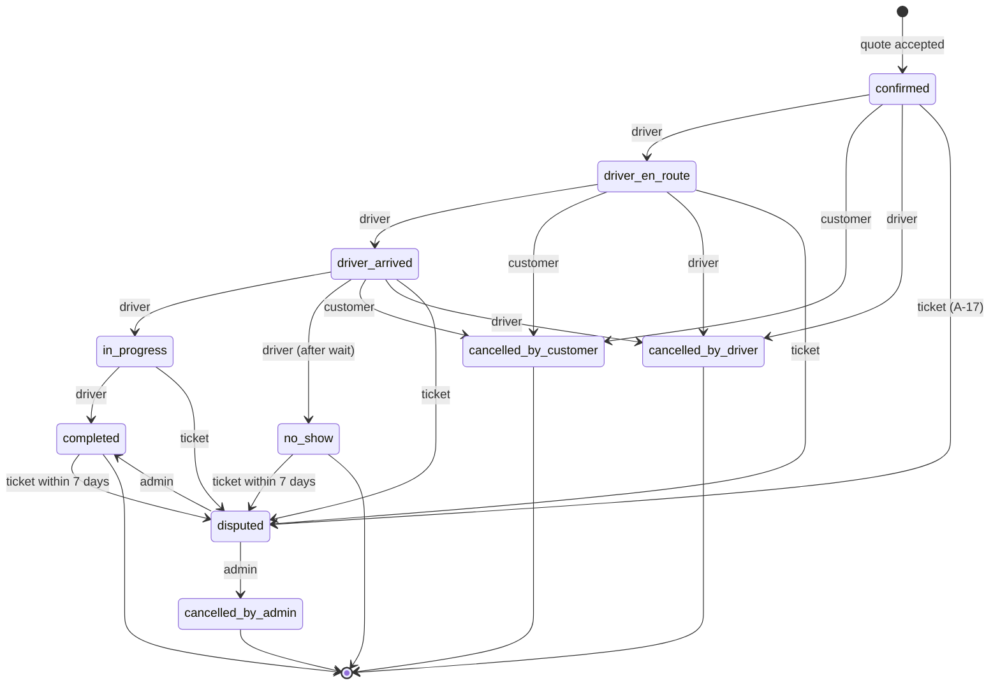

# F-08 — Bookings lifecycle

| | |
| --- | --- |
| Requirements | FR-BKG-001 … FR-BKG-014 |
| Priority / release | P0 (FR-BKG-007, 009, 011, 012 P1; FR-BKG-014 P2) · R1 |
| Contract | `bookings.ts` (`Booking`, `BookingStatus`, `DRIVER_BOOKING_TRANSITIONS`, `CANCELLABLE_BOOKING_STATUSES`, `ACTIVE_BOOKING_STATUSES`, `CancellationReason`, `CancelBookingRequest`, `TransitionBookingRequest`, `CancellationPolicy`, `BookingFare`, `BookingParty`, `BookingEvent`, `BookingAction`, `BookingListQuery`, `Receipt`); `ApiRoutes.bookings.*`, `ApiRoutes.driver.bookings`, `ApiRoutes.admin.{bookings, booking, resolveDispute}` |
| API module | `apps/api/src/modules/bookings` |
| Web | `features/booking` (customer), `features/partner` (driver), `features/admin` |

## 1. Business objective and scope

Once a quote is accepted both sides need one shared, trustworthy record of
the trip: who, what, when, how much, what state it is in, and what each may
do next.

**In scope** — the booking record; lists and detail for customer and driver;
driver status transitions; cancellation and the frozen policy; contact
disclosure; receipt; no-show; dispute state and admin resolution; timeline.
**Out of scope** — creation (F-07 accept); reviews and tickets (F-09);
collecting the fare (A-02); refunds of platform charges (P2).

## 2. User stories and acceptance criteria

- **US-01** As a customer I see my driver, vehicle, plate, price and what is
  included — and I can call the driver.
- **US-02** As a driver I move the trip forward: on my way, arrived, started,
  completed.
- **US-03** As either party I can cancel while it is still possible, and I
  know beforehand what that costs.
- **US-04** As a customer I can get a receipt.
- **US-05** As support I can settle a disputed booking.

| AC | Given | When | Then |
| --- | --- | --- | --- |
| AC-F08-01 | a quote was just accepted | the booking is read by its customer | `200 Booking` with a unique `code` matching `^PY-[0-9A-HJKMNP-TV-Z]{5}$` ◊, `status: "confirmed"`, trip fields copied from the request, `fare.quoted = quote.fare`, `fare.bookingFee`, `fare.total`, `inclusions`, `exclusions`, `pickupNote`, `cancellationPolicy`, `vehicle.registrationNumber` (full), `timeline` with one `confirmed` event by `customer`, and `allowedActions` |
| AC-F08-02 | booking fee disabled | a booking is created | `fare.bookingFee.amountMinor = 0` and `fare.total = fare.quoted`; with the fee enabled (flat ₹10, 2 %, cap ₹50) and a ₹2 000 quote → fee ₹50; values are frozen on the booking and do not change when settings change later |
| AC-F08-03 | a booking in `ACTIVE_BOOKING_STATUSES` | each party reads it | the customer sees `driver.phone`; the driver sees `customer.phone`; once the status leaves the active set both `phone` values are `null` |
| AC-F08-04 | a user who is neither party | `GET /bookings/{id}` | `404 not_found` |
| AC-F08-05 | a customer with upcoming, in-progress, completed and cancelled bookings | `GET /bookings?scope=active` / `past` / `all` | `active` = statuses in `ACTIVE_BOOKING_STATUSES` ordered by `scheduledAt` ascending; `past` = all others ordered by `scheduledAt` descending; `all` = both; paginated |
| AC-F08-06 | the driver of a `confirmed` booking | `POST /bookings/{id}/transitions { to: "driver_en_route" }` | `200 Booking` with the new status and a timeline event `{ actor: "driver" }`; the customer is notified `booking_status_changed` |
| AC-F08-07 | each status | the driver requests each target | only pairs in `DRIVER_BOOKING_TRANSITIONS` succeed; every other pair → `409 invalid_transition`; the customer calling the transition route → `403 forbidden` |
| AC-F08-08 | a `driver_arrived` booking | driver transitions to `no_show` | allowed only ≥ 10 min ◊ after the `driver_arrived` event; earlier → `409 invalid_transition` with a detail stating when it becomes possible |
| AC-F08-09 | an `in_progress` booking | driver transitions to `completed` | `status: "completed"`, `completedAt` set; driver's `completedTrips` increments; `allowedActions` for the customer now include `review`, `view_receipt`, `report_issue` |
| AC-F08-10 | a booking in `CANCELLABLE_BOOKING_STATUSES` | the customer posts `/cancel` with a `CancellationReason` | `200` `status: "cancelled_by_customer"`, `cancellation` set with `feeCharged` per the frozen policy; the driver is notified `booking_cancelled`; phones become `null` |
| AC-F08-11 | the same | the driver posts `/cancel` | `status: "cancelled_by_driver"`, `feeCharged` zero; the cancellation counts toward the driver's `cancellationRate` |
| AC-F08-12 | a booking that is `in_progress`, `completed` or already cancelled | cancel | `409 cancellation_not_allowed` |
| AC-F08-13 | `reason: "other"` without `note` | cancel | `400 validation_failed` |
| AC-F08-14 | cancel repeated after success | cancel | `409 cancellation_not_allowed` and the booking is unchanged (no second event, no second notification) |
| AC-F08-15 | a `completed` booking | a party calls `GET /bookings/{id}/receipt` | `200 Receipt` with `paymentNote` "Paid directly to the driver" (plus the booking-fee line when non-zero); for any other status → `409 conflict`; non-party → `404` |
| AC-F08-16 | a driver | `GET /driver/bookings?scope=active` | only bookings where they are the driver, with the same scoping rules |
| AC-F08-17 | a booking made `disputed` (F-09 AC-F09-12) | an admin with `bookings.resolve` posts `/admin/bookings/{id}/resolve { outcome, note }` | `200 Booking` with status `completed` or `cancelled_by_admin`, a timeline event `{ actor: "admin", note }`; both parties notified; audit `booking.dispute_resolved`; resolving a booking that is not `disputed` → `409 invalid_transition` |
| AC-F08-18 | an admin with `bookings.read` only | lists `/admin/bookings`, opens one, tries to resolve | list and detail succeed (phones visible to admins only inside an active or disputed booking); resolve → `403 forbidden` |
| AC-F08-19 | any status change | the timeline is read | events are in chronological order, immutable, one per change, with `actor` ∈ `customer` \| `driver` \| `admin` \| `system` |
| AC-F08-20 | `allowedActions` for each role and status (table in §3) | the booking is read | exactly the listed actions are returned; any action not listed is refused by the API when attempted |

## 3. Preconditions, postconditions and business rules

**Preconditions** — the booking exists (created only by F-07 accept).

**Status machine**

**`allowedActions` (server-computed)**

| Status | Customer | Driver |
| --- | --- | --- |
| `confirmed` | `cancel`, `report_issue` | `mark_en_route`, `cancel`, `report_issue` |
| `driver_en_route` | `cancel`, `report_issue` | `mark_arrived`, `cancel`, `report_issue` |
| `driver_arrived` | `cancel`, `report_issue` | `start_trip`, `mark_no_show` (after wait), `cancel`, `report_issue` |
| `in_progress` | `report_issue` | `complete`, `report_issue` |
| `completed` | `review` (if eligible, F-09), `view_receipt`, `report_issue` | `view_receipt`, `report_issue` |
| `no_show` | `report_issue` | `report_issue` |
| cancelled (any) | `report_issue` | `report_issue` |
| `disputed` | — | — |

| # | Rule |
| --- | --- |
| BR-01 | A booking is immutable in its trip terms (places, time, fare, inclusions). Changes mean cancel and re-request. |
| BR-02 | `code`: `PY-` + 5 characters of Crockford base-32 (no I, L, O, U) ◊, unique, generated with retry on collision. |
| BR-03 | `scheduledAt` for an immediate trip is the confirmation time. |
| BR-04 | Fee at acceptance: `fee = min(cap, flatMinor + round(percent/100 × quoted))` when `BookingFeeSettings.enabled`, else 0. Frozen. |
| BR-05 | Default `CancellationPolicy` ◊ (D-11): `freeUntilMinutesBefore = 60` for advance trips, `0` for immediate; `lateFee = 0` while no payment adapter can collect it (A-08); `summary` generated in plain language. Frozen on the booking. |
| BR-06 | `cancellation.feeCharged` = `lateFee` if the customer cancels later than `freeUntilMinutesBefore` before `scheduledAt`, else 0. Drivers are never charged; their cancellations affect `cancellationRate`. |
| BR-07 | Phone disclosure: only inside `ACTIVE_BOOKING_STATUSES`, only to the counter-party (and to admins with `bookings.read` while active or disputed). |
| BR-08 | Only the booking's driver may transition; transitions are validated against `DRIVER_BOOKING_TRANSITIONS` with optimistic locking (`version`) so two taps cannot skip a state. |
| BR-09 | `no_show` requires a wait of 10 min ◊ after arrival. |
| BR-10 | `disputed` freezes all party actions; only an admin resolves it. Entry is by ticket (A-17, F-09). |
| BR-11 | Every change writes a `booking_events` row in the same transaction and an outbox event for notifications. |
| BR-12 | A driver may hold several upcoming bookings; the platform does not prevent overlapping bookings at R1 but warns the driver in the quote form ◊. |
| BR-13 | Bookings are retained 8 years with personal fields anonymised on erasure (NFR-PRIV-003). |

## 4. Workflows

**Primary** — Customer: bookings list → detail (status header with a step
indicator, driver card with call button, vehicle with plate, fare breakdown,
inclusions/exclusions, policy, timeline) → after completion: review, receipt.
Driver: bookings list → detail → single primary action button per state →
completed.

| # | Alternative | Behaviour |
| --- | --- | --- |
| ALT-1 | Customer cancels late | Confirm dialog shows the fee from the policy before confirming |
| ALT-2 | Driver cannot make it | Cancels with a reason; customer is offered *Ask again* (prefilled request) |
| ALT-3 | Customer not at pickup | After the wait, *Customer didn't show* → `no_show` |
| ALT-4 | Disagreement | *Report an issue* → ticket (F-09) → `disputed` if category qualifies |
| ALT-5 | Driver forgets to complete | Job flags `in_progress` bookings older than 24 h ◊ for support; nothing auto-completes |
| ALT-6 | Two devices tap the same transition | The second receives `409 invalid_transition` and refreshes |

## 5. Loading, empty, error, retry and offline states

| State | Behaviour |
| --- | --- |
| Loading | List skeletons; detail skeleton with the status header first |
| Empty | Customer: "No trips yet" + *Find a ride*. Driver: "No bookings yet" + inbox link |
| Error | List/detail error with *Try again*; failed action shows the server message and refreshes the booking |
| Retry | Transitions and cancel are guarded server-side; the client refreshes then re-offers only `allowedActions` |
| Offline | Last loaded booking remains readable (driver name, plate, pickup, phone link) with an "Offline" marker; actions disabled. Polling (15 s ◊ while active) resumes on reconnect |

## 6. API and database changes

| Operation | Request → response | Access |
| --- | --- | --- |
| `GET /bookings` | `BookingListQuery` → `Paginated<Booking>` | customer |
| `GET /bookings/{bookingId}` | — → `Booking` | party |
| `POST /bookings/{bookingId}/cancel` | `CancelBookingRequest` → `Booking` | party |
| `POST /bookings/{bookingId}/transitions` | `TransitionBookingRequest` → `Booking` | driver of the booking |
| `GET /bookings/{bookingId}/receipt` | — → `Receipt` | party, completed only |
| `GET /driver/bookings` | `BookingListQuery` → `Paginated<Booking>` | driver |
| `GET /admin/bookings` | `AdminBookingQuery` → `Paginated<AdminBookingRow>` | `bookings.read` |
| `GET /admin/bookings/{bookingId}` | — → `Booking` | `bookings.read` |
| `POST /admin/bookings/{bookingId}/resolve` | `ResolveDisputeRequest` → `Booking` | `bookings.resolve` |

Tables: `bookings` (unique `code`, `request_id`, `quote_id`; indexes on
`(customer_id, scheduled_at)`, `(driver_profile_id, scheduled_at)`,
`(status)`), `booking_events` (append-only).

## 7. Authorisation and security

- Party check on every read and write; non-parties get `404` (IDOR, T-10).
- The transition route is driver-only; cancel is party-only; resolve is
  permission-gated and audited.
- Phone numbers are added to the response by the serializer only when BR-07
  holds; they are never cached by the service worker.
- Admin list rows (`AdminBookingRow`) carry names but no phone numbers.
- Full registration number is shown only to parties and admins.

## 8. Validation rules

| Field | Rule |
| --- | --- |
| `bookingId` | UUID |
| `TransitionBookingRequest.to` | `BookingStatus`; must be allowed from the current status for a driver |
| `CancelBookingRequest.reason` | `CancellationReason` |
| `note` | ≤ 300 chars; required when `reason = "other"` or `"safety_concern"` |
| `BookingListQuery.scope` | `active` \| `past` \| `all`; default `active` |
| `AdminBookingQuery.status` | `BookingStatus` |
| `q` | 2–60 chars; matches `code`, customer or driver name |
| `from`, `to` | ISO dates, `from ≤ to`, range ≤ 366 days |
| `ResolveDisputeRequest.outcome` | `completed` \| `cancelled_by_admin` |
| `ResolveDisputeRequest.note` | 5–500 chars |

## 9. Test cases

| ID | Level | Case |
| --- | --- | --- |
| UT-F08-01 | Unit | Status machine: full matrix of from × to × actor |
| UT-F08-02 | Unit | `allowedActions` table for every status and role |
| UT-F08-03 | Unit | Booking-fee formula incl. cap and rounding (AC-02) |
| UT-F08-04 | Unit | Cancellation fee by time before pickup (BR-06) |
| UT-F08-05 | Unit | Phone-disclosure policy (BR-07) |
| UT-F08-06 | Unit | Booking code format and collision retry |
| IT-F08-01 | Integration | Booking snapshot after accept (AC-01, 02) |
| IT-F08-02 | Integration | Party visibility, phone disclosure before/after (AC-03, 04) |
| IT-F08-03 | Integration | Lists and scopes for customer and driver (AC-05, 16) |
| IT-F08-04 | Integration | Full driver transition path, invalid transitions, concurrent taps (AC-06…09) |
| IT-F08-05 | Integration | Cancellation by each party, late cancel, repeats (AC-10…14) |
| IT-F08-06 | Integration | Receipt (AC-15) |
| IT-F08-07 | Integration | Dispute resolution and admin permissions (AC-17, 18) |
| E2E-F08-01 | E2E | Driver walks a booking to completion; customer sees each status within one poll |
| E2E-F08-02 | E2E | Customer cancels; driver sees the cancellation and the customer's phone disappears |
| NT-F08-01 | Negative | Non-party and anonymous access to every booking route |
| NT-F08-02 | Negative | Customer attempts a transition; driver attempts to resolve a dispute |
| NT-F08-03 | Negative | `other` without note; unknown status; malformed IDs |

## 10. Performance and accessibility

- Detail p95 ≤ 300 ms; list ≤ 400 ms; polled detail supports `ETag`/`304`.
- Status is conveyed by text and a labelled step list (`aria-current="step"`),
  not colour alone; status changes are announced politely.
- The call action is a `tel:` link with the driver's name in its accessible
  name; the cancel dialog is a modal with focus trap and a clear statement of
  the fee.
- The driver's primary action is one large button (≥ 48 px high) reachable
  with one thumb at 320 px.

## 11. Deployment, rollback and observability

- **Config** ◊: no-show wait, default policy values, polling interval.
- **Rollback**: bookings are data; schema change rollback only before data
  exists. A defective transition rule is mitigated by deploying the previous
  version — state already written remains valid because states are additive.
- **Metrics**: bookings by status; completion rate; cancellation rate by
  party and reason; time in each state; no-show rate; disputed count.
- **Alerts**: `in_progress` > 24 h; disputed bookings unresolved > 72 h ◊
  (business).
- **Audit**: `booking.created`, `booking.transitioned`, `booking.cancelled`,
  `booking.dispute_opened`, `booking.dispute_resolved`.

## 12. Gaps and assumptions

| # | Item |
| --- | --- |
| G-1 | **No operation moves a booking to `disputed`**; this spec assumes the ticket trigger of A-17. |
| G-2 | `POST /bookings/{id}/cancel` is not marked `(idem)`; repeat-safety relies on the state check (AC-14). |
| G-3 | `Receipt` and `Invoice` have no tax fields (NFR-COMP-003). |
| G-4 | No refund operation for `cancellation.feeCharged` or `bookingFee` (FR-BKG-014, P2). |
| G-5 | No reschedule operation; BR-01 makes it cancel + re-request. |
| G-6 | No live location or ETA sharing during the trip. |
| G-7 | `BookingAction` has no "call" action; contact is implied by `phone` being non-null. |
| A-1 | Policy defaults, the no-show wait and the booking-code alphabet are spec defaults. |
| A-2 | Overlapping bookings are allowed and only warned about. |
