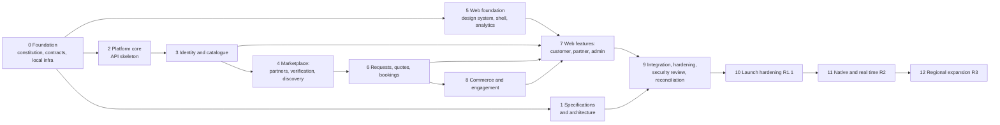

# Payana — Implementation Plan

*Version 1.0 · 2026-11-10*

The plan follows the constitution's order: constitution → product
requirements → feature specifications → architecture → API contracts → data
model → implementation plan → code → tests → security review → release.
Phases 0–1 produce contracts and documents; phases 2–9 produce Release 1;
phases 10–12 are later releases.

This document states **what is planned**. What has actually been built and
verified is recorded only in `traceability-matrix.md`.

## 1. Work streams

| Stream | Owns | Depends on |
| --- | --- | --- |
| **Contracts** | `packages/contracts` | Constitution, PRD |
| **Specs** | `specs/**` except `constitution.md`, `_source/`, `api/openapi.yaml` | Contracts |
| **API** | `apps/api`, `specs/api/openapi.yaml` (generated) | Contracts |
| **Web** | `apps/web` | Contracts; API for integration |
| **Infrastructure** | `docker-compose.yml`, `infra/terraform`, `.github/workflows` | API and web build shapes |

The contract package is the hand-shake: streams run in parallel once it
exists, and integrate against it.

## 2. Phases

### Phase 0 — Foundation

| Deliverable | Exit criteria |
| --- | --- |
| `specs/constitution.md`, source brief saved with the truncation recorded | Reviewed; version 1.0 |
| `packages/contracts` (types, enums, constants, `ApiRoutes`) | Builds to CJS + ESM + types; smoke-imported from both module systems |
| Repository skeleton, `.gitignore`, root scripts | `npm run setup` works on a clean clone |
| `docker-compose.yml` (PostgreSQL + PostGIS, Redis) | `npm run infra:up` healthy; host ports do not collide with local services |

### Phase 1 — Specifications and architecture (this document set)

| Deliverable | Exit criteria |
| --- | --- |
| PRD, personas and journeys, FR and NFR catalogues | Every brief bullet mapped (FR §20); assumptions and owner decisions listed |
| Feature specs F-01 … F-18 | Each has all twelve sections; ACs in Given/When/Then; gaps recorded |
| System design, 17 ADRs, target data model | Diagrams valid; consistent with the contract |
| Threat model, test strategy, release plan | Abuse cases mapped to requirements; gates defined; blockers listed |
| Traceability matrix (all `planned`) | One row per FR/NFR |

### Phase 2 — Platform core (API skeleton) · F-18

| Deliverable | Exit criteria |
| --- | --- |
| NestJS application, configuration schema, structured logging, request IDs | AC-F18-03, -16 |
| Exception filter → `ProblemDetails`; validation pipe; pagination | AC-F18-04, -05 |
| Database module, first migration (extensions), migration and seed tooling | AC-F18-09 |
| Redis module, rate limiter, distributed lock, scheduler | AC-F18-10, -11 |
| Audit service, outbox + worker, idempotency interceptor | AC-F18-06, -12; F-15 AC-05…07 |
| Storage port (local + S3 adapters), SMS port (dev), payment port (manual) | Adapter contract tests |
| Health endpoints, OpenAPI generation and export script | AC-F18-01, -02, -07 |
| Access-declaration metadata + global guard skeleton (default deny) | Start-up fails on undeclared route |

### Phase 3 — Identity and catalogue · F-01, F-02, F-03, settings part of F-16/F-14

| Deliverable | Exit criteria |
| --- | --- |
| OTP request/verify, sessions, refresh rotation, logout, session list | AC-F01-01 … -15, -22 |
| Admin login, TOTP enrolment/verify, permission resolver | AC-F01-16 … -20 |
| `/me`, saved places, emergency contact, consents, deletion request + erasure job | AC-F02-01 … -13 |
| Regions, categories, places, fare estimate, public config | AC-F03-01 … -08, -13 |
| Settings read/write with validation; feature flags | AC-F16-08 … -10; AC-F14-13, -14 |
| Seed: regions, categories, places, settings, first `super_admin` | Seed idempotent |

### Phase 4 — Marketplace · F-04, F-05, F-06

| Deliverable | Exit criteria |
| --- | --- |
| Partner profile, vehicles, rates, uploads, documents, checklist, submit | AC-F04-01 … -13 |
| Availability, location pings, freshness | AC-F04-14 … -18 |
| Owner↔driver authorisations | AC-F04-19 … -21 |
| Verification queue, case, document review, decisions, listing moderation, expiry job | AC-F05-01 … -15 |
| *Listed* gate maintained and exported | UT-F05-03 |
| Nearby search (PostGIS), filters, sorts, public profile | AC-F06-01 … -14; NFR-PERF-002 plan assertion |

### Phase 5 — Web foundation · F-13, F-14, F-17 (parallel with 2–4)

| Deliverable | Exit criteria |
| --- | --- |
| Angular 22 app, strict TS, lazy routes, PWA, budgets | Build within NFR-PERF-004 |
| Tokens, base styles, palette / literal / contrast checks | AC-F13-01 … -03 |
| Component set, illustrations, icon sprite, motion directives | AC-F13-10 … -13 |
| Core: typed API client, auth session + interceptors, config loader with fallback | F-01 UT-06; AC-F14-16 |
| Platform adapters; offline banner; update prompt | AC-F17-02 … -09 |
| Analytics port, gtag adapter, consent store and banner | AC-F14-01 … -08, -21 |
| Shell (top bar, mobile nav, footer) and landing page | AC-F13-05 … -09, -14, -15 |

### Phase 6 — Requests, quotes, bookings · F-07, F-08

| Deliverable | Exit criteria |
| --- | --- |
| Ride requests (four trip types), validation windows, fan-out, limits, expiry | AC-F07-06 … -18 |
| Driver inbox, quotes, withdraw, decline | AC-F07-19 … -27 |
| Accept with row lock + idempotency | AC-F07-28 … -33; 20-way concurrency test |
| Booking record, lists, detail, transitions, cancellation, receipt, no-show | AC-F08-01 … -16, -19, -20 |
| Admin bookings and dispute resolution | AC-F08-17, -18 |

### Phase 7 — Web features · customer, partner, admin

| Deliverable | Exit criteria |
| --- | --- |
| Auth screens (phone OTP; admin + TOTP) | E2E-F01-01 … -03 |
| Explore: list, radar, filters, profile | AC-F06-15; E2E-F06-01, -02 |
| Booking: location picker, request form, request page, booking pages | AC-F07-01 … -05; E2E-F07-01 |
| Account: profile, places, emergency contact, privacy, sessions, deletion | E2E-F02-01, -02 |
| Partner: onboarding, vehicles, documents, dashboard, inbox, quote, bookings, subscription | E2E-F04-01, -02 |
| Admin: shell by permission, overview, verification, users, bookings, settings (incl. Analytics & Ads), audit, plans, packages, ads, tickets, staff | E2E-F16-01 … -03; AC-F14-13 … -15 |
| Packages pages; legal drafts | E2E-F10-01; AC-F13-18 |

### Phase 8 — Commerce and engagement · F-09, F-10, F-11, F-12, F-15

| Deliverable | Exit criteria |
| --- | --- |
| Notifications from outbox; list / read | AC-F15-01 … -12 |
| Reviews, replies, moderation, aggregates | AC-F09-01 … -08 |
| Support tickets, admin queue, dispute trigger | AC-F09-09 … -19 |
| Packages public + admin | AC-F10-01 … -11 |
| Plans, subscriptions (manual adapter), invoices, entitlements, renewal job | AC-F11-01 … -11, -16, -17 |
| Featured placements; booking-fee settings | AC-F11-12 … -15, -18 … -20 |
| Ad serving, events, campaigns, status job | AC-F12-01 … -15 |
| Admin overview, users, staff, audit viewer | AC-F16-01 … -07, -11 … -17 |

### Phase 9 — Integration, hardening and reconciliation

| Deliverable | Exit criteria |
| --- | --- |
| Full stack run: web against API with seeded data | E2E-F18-01 green |
| Generated access matrix, ownership, audit-coverage, privacy-payload suites | All green; zero undeclared routes |
| OpenAPI exported and committed; drift check in CI | AC-F18-07, -08 |
| Accessibility and performance passes | NFR-A11Y-006; NFR-PERF-003, -004 |
| CI workflows; Terraform `validate` | AC-F18-14, -15 |
| Security review checklist (threat model §8) items that do not need production | Recorded |
| **Traceability reconciliation**: every row set to `built` / `partial` / `stubbed` / `planned` from actual code and test results; specs corrected where the implementation legitimately differs (◊ values); contract gaps confirmed or closed | Matrix reviewed; no row claims more than the evidence shows |
| README and developer guide | A new engineer reaches a running stack from the README alone |

**R1 exit** = PRD §11.

### Phase 10 — Launch hardening (R1.1)

Closes `deployment/release-plan.md` §8: real SMS adapter and DLT; payment
gateway adapter, webhook, reconciliation; change-password and factor reset;
admin operations for places; malware scanning; WAF; legal documents;
penetration test; production infrastructure applied with restore drill;
Kannada translations if required (A-24); map/geocoding decision (D-05).

### Phase 11 — Native and real time (R2)

Capacitor Android then iOS with native adapters (push, secure token store,
background location for drivers, camera, deep links); SSE for request and
booking streams; notification templates and delivery status; refunds;
coupons; financial reporting; email sign-in and linking; passkeys for
administrators.

### Phase 12 — Regional expansion (R3)

Kumta, Honnavar, Murudeshwar, Karwar switched live by the runbook
(release plan §9); per-region pricing if needed; fleet reporting.

## 3. Dependencies that can stall the plan

| Dependency | Needed by | If late |
| --- | --- | --- |
| Remainder of the brief (D-08) | Phase 1 completeness | Re-open specs when received; R1 proceeds on §1/§5 |
| Docker available for PostGIS/Redis | Phases 2–9 (integration tests) | Integration tests cannot run locally; CI becomes the only evidence |
| Contract stability | Phases 3–8 | Additive changes only; breaking changes are coordinated across streams the same day |
| Owner decisions D-01, D-02, D-03, D-04 | Phase 10 | Launch date moves; R1 unaffected |
| AWS account, domain | Phase 10 | Terraform stays unapplied |
| Map provider (D-05) | After pilot | Curated places remain |

## 4. Risks to delivery

| Risk | Likelihood | Impact | Response |
| --- | --- | --- | --- |
| Toolchain versions newer than available guidance (NestJS 12, TypeORM 1.x, Angular 22, TypeScript 6) | Medium | Medium | Pin exact versions; let type-checking and integration tests find API differences early; record deviations in ADRs |
| Web and API drift | Medium | High | Shared contracts; `ApiRoutes` on both sides; early full-stack smoke; OpenAPI drift gate |
| Scope: 208 requirements in one release | High | High | P0 first, end to end; P1 honestly `partial`/`stubbed` rather than thinly "done"; nothing silently dropped |
| Spec defaults (◊) differ from implementation | High | Low | Reconciliation in phase 9 updates the spec to the implemented value or files a defect |
| Accessibility debt in custom components | Medium | Medium | Native inputs first; headless primitives allowed (ADR-0008); axe gate from the first screen |
| PWA limits hurt driver engagement | Medium | High | Honest UI; decision point to pull the Android shell forward (ADR-0007) |
| Polling load | Low | Medium | `ETag`, visibility rules; SSE planned |

## 5. Definition of done per phase

A phase is complete when its exit criteria are met **and**:

1. The acceptance criteria cited are covered by passing automated tests, or
   the gap is written into the traceability matrix.
2. Lint, type-check and build pass for every package touched.
3. New endpoints declare access and appear in the exported OpenAPI document.
4. New screens implement loading, empty, error, retry and offline states.
5. Audit entries exist for new security-relevant actions.
6. The matrix rows for the requirements touched are updated in the same
   change.
