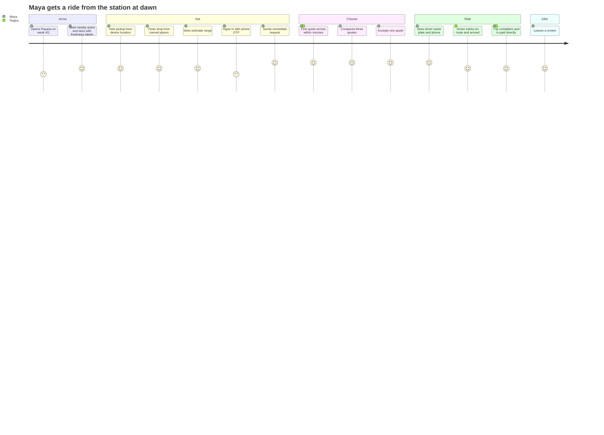
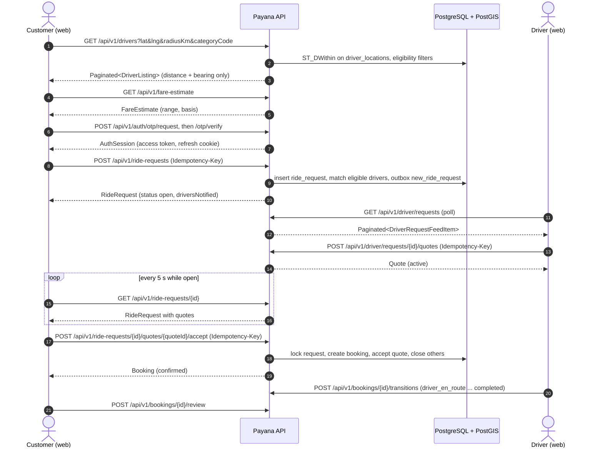
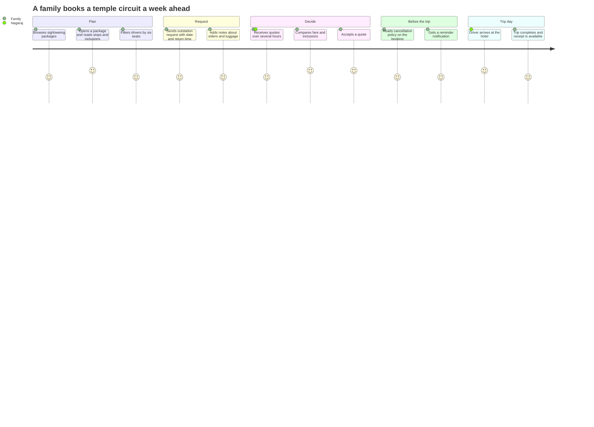
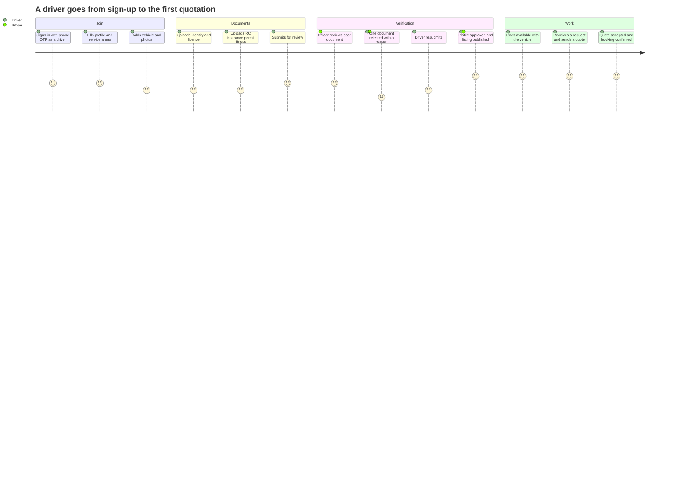
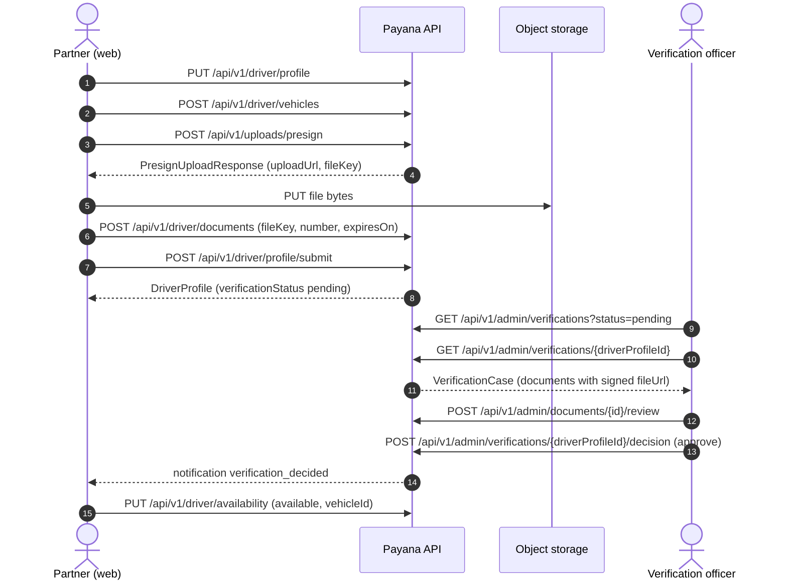
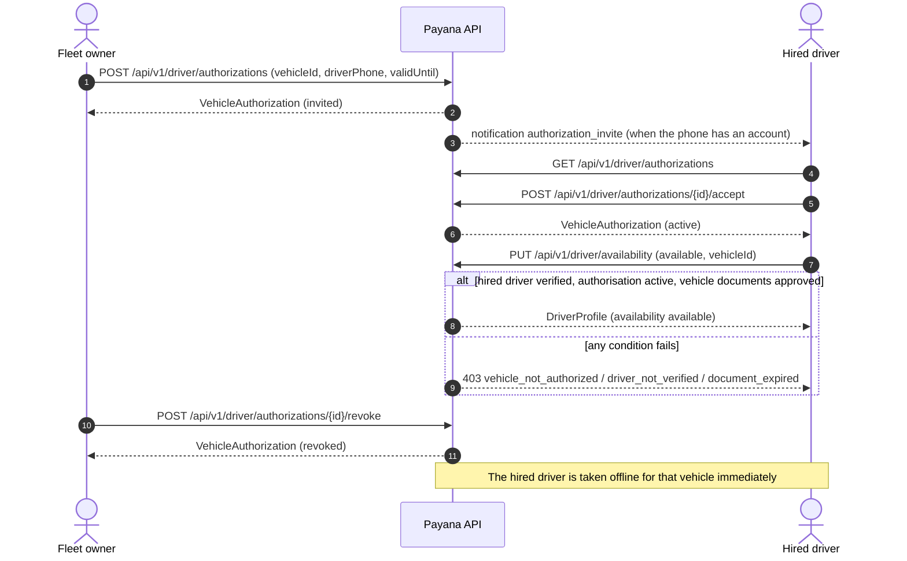

# Payana — Personas and Journeys

*Version 1.0 · 2026-11-10*

Personas are composites used to test decisions. They are not market research;
see `product-requirements.md` §9 for what is assumed.

## 1. Personas

### Customers (`AccountRole.Customer`)

| Persona | Context | Needs | Frustrations | What Payana must do |
| --- | --- | --- | --- | --- |
| **Maya, 29 — visiting tourist** | Arrives at Gokarna Road station at 06:10 with a backpack; staying near Kudle Beach; mid-range Android, intermittent 4G; reads English | A ride now at a fair price; an idea of cost before she agrees; to know the driver is legitimate | Being quoted "tourist price"; no reference fare; drivers who do not show | Estimate range before requesting; several quotes side by side; verified badge that means something; driver phone only after booking |
| **The Hegde family — pilgrims, 6 people incl. two elders** | Day trip Gokarna → Murudeshwar → Idagunji and back, planned a week ahead from Hubballi | One vehicle that seats six with luggage; a fixed all-in price; pickup at a set time | Phone tag with hotel desks; unclear inclusions (tolls, driver allowance, waiting) | Advance and outstation requests; `minSeats` filter; quotes with explicit inclusions/exclusions; sightseeing packages |
| **Suresh, 54 — resident** | Lives in Gokarna; no smartphone habit beyond WhatsApp; needs hospital runs to Kumta and early bus-stand drops | A known, reliable driver; repeat booking | Apps that assume English fluency and fast data | Small, fast pages; saved places; direct request to a driver he has used (`targetDriverId`); Kannada later (NFR-I18N-001) |

### Partners (`AccountRole.Driver`)

| Persona | `PartnerType` | Context | Needs | What Payana must do |
| --- | --- | --- | --- | --- |
| **Raghu, 38 — auto driver** | `owner_driver` | Owns one auto; stand near the Car Street; entry-level Android; data-conscious | More fares in the off-season; no commission; simple screens | Free tier that works; one-tap availability; quote in two fields; no background battery drain claims the PWA cannot keep |
| **Nagaraj, 45 — taxi owner-driver** | `owner_driver` | Owns an Ertiga; does airport (Goa/Hubballi) and temple circuits | Advance bookings; to be seen above casual listings; reviews as reputation | Advance/outstation inbox; paid plan with priority and badge; featured placement in season; reply to reviews |
| **Shanta, 51 — fleet owner** | `fleet_owner` | Owns four vehicles, drives none; employs drivers | List all vehicles; prove which driver may drive which vehicle; see performance | Multiple vehicles within `maxVehicles`; `VehicleAuthorization` invitations; metrics |
| **Imran, 26 — hired driver** | `hired_driver` | Drives Shanta's Innova; has his own licence, no vehicle | To take bookings on the vehicle he drives without owning it | Accept an authorisation; go available only with an authorised, verified vehicle |

### Administrators (`AccountRole.Admin`)

| Persona | `AdminRole` | Daily work | Must be able to | Must **not** be able to |
| --- | --- | --- | --- | --- |
| **Kavya — verification officer** | `verification_officer` | Works the verification queue; checks documents against numbers and expiry | Read users; read and review verification cases; moderate listings | See bookings, money, settings, audit log; manage staff |
| **Deepak — support agent** | `support_agent` | Answers tickets; mediates disputes; suspends abusive accounts | Read users; suspend/reinstate; read bookings; resolve disputes; manage tickets; moderate reviews; read verification cases | Approve documents; change plans, ads or settings |
| **Anjali — finance manager** | `finance_manager` | Plans, reconciliation, refunds, reports | Read bookings; manage plans; reconcile payments; process refunds; financial reports | Review documents; manage ads; change settings |
| **Rohan — marketing manager** | `marketing_manager` | Sells and schedules local ads; curates packages | Manage ad campaigns and packages; manage notifications; **read** settings | Change settings; see users or bookings |
| **The owner — super admin** | `super_admin` | Configuration, staff, flags, analytics identifiers | Everything in `Permission`; the only role with `settings.manage`, `staff.manage`, `audit.read`, `catalog.manage` | Sign in without MFA |

The authoritative mapping is `ADMIN_ROLE_PERMISSIONS` in
`packages/contracts/src/identity.ts`.

## 2. Journeys

### J-1 Immediate ride (Maya)

### J-2 Advance outstation day trip (Hegde family)

Rules exercised: `MIN_ADVANCE_NOTICE_MINUTES`, `MAX_ADVANCE_DAYS`,
`REQUEST_TTL_MINUTES.outstation`, `returnAt > scheduledAt`, frozen
`CancellationPolicy`, `Receipt`.

### J-3 Repeat ride with a known driver (Suresh)

1. Suresh opens Raghu's public profile (`GET /drivers/{id}`).
2. He taps *Request this driver*; the request carries `targetDriverId`.
3. Only Raghu sees it, flagged `directRequest: true`.
4. Raghu quotes; Suresh accepts. If Raghu declines or the request expires,
   Suresh is offered "ask everyone nearby" — a new request without
   `targetDriverId`.

### J-4 Owner-driver onboarding to first quote (Raghu / Nagaraj)

### J-5 Fleet owner authorises a hired driver (Shanta and Imran)

### J-6 Subscription purchase (Nagaraj)

1. Opens the plans page (`GET /plans`), compares entitlements.
2. `POST /driver/subscription/checkout` with `planId` and an idempotency key.
3. With `PaymentProvider.Manual` the `CheckoutSession.status` is `completed`
   immediately; with a gateway it is `requires_action` and the hosted
   checkout opens (R1.1).
4. `GET /driver/subscription` shows the new plan and period; `GET
   /driver/invoices` lists the invoice.
5. Listing shows the plan badge; search ranks him ahead of free listings when
   otherwise equal.

### J-7 Verification officer's shift (Kavya)

1. Signs in at `/admin` with email, password and TOTP.
2. Works the queue oldest-first; opens a case; views each document through a
   signed link that expires in minutes.
3. Approves or rejects each document with a `DocumentRejectionReason`.
4. Decides the case: `approve`, `request_changes`, `reject`.
5. Each action is in the audit log; the partner is notified.
6. She cannot open Bookings, Plans, Settings or Audit — the items are absent
   from her navigation and the API returns `403 forbidden` if called.

### J-8 Dispute (Deepak)

1. A customer opens a ticket of category `fare_dispute` against a booking.
2. The booking moves to `disputed` (assumption A-17).
3. Deepak reads the booking timeline and the ticket thread, messages both
   parties, and resolves with `ResolveDisputeRequest`
   (`completed` or `cancelled_by_admin`) and a note.
4. Both parties are notified; the decision is audited.

### J-9 Owner adds Google accounts later

1. Signs in as `super_admin`; opens Admin → Settings → Analytics & Ads.
2. Pastes the GA4 measurement ID, the Google Ads tag ID and conversion labels.
3. Saves; invalid formats are rejected field by field.
4. Within 60 s every newly loaded client reads the new `PublicConfig`;
   tags load only for visitors who have consented.

The full procedure is in `features/F-14-analytics-and-ads.md` §13.

### J-10 Privacy: withdraw consent and delete account (any user)

1. Account → Privacy: toggles `analytics` and `advertising` off →
   `PUT /me/consents`; Consent Mode is updated to `denied` immediately.
2. Requests deletion → `POST /me/deletion-request`; status shows
   `scheduledFor` = now + `ACCOUNT_DELETION_GRACE_DAYS`.
3. May cancel with `DELETE /me/deletion-request` until that moment.
4. After the grace period the erasure job anonymises the account.

## 3. Cross-cutting needs by persona

| Need | Maya | Family | Suresh | Raghu | Nagaraj | Shanta | Imran | Admins |
| --- | --- | --- | --- | --- | --- | --- | --- | --- |
| Works at 320 px width, slow 4G | ● | ● | ● | ● | ● | ○ | ● | ○ |
| Desktop/tablet layout | ○ | ● | ○ | ○ | ○ | ● | ○ | ● |
| Offline shell and clear offline state | ● | ○ | ● | ● | ● | ○ | ● | ○ |
| Kannada UI (later) | ○ | ● | ● | ● | ● | ● | ● | ○ |
| Explicit inclusions / exclusions | ● | ● | ○ | ● | ● | ● | ● | ● |
| Keyboard and screen-reader operable | ● | ● | ● | ● | ● | ● | ● | ● |

● primary · ○ secondary
