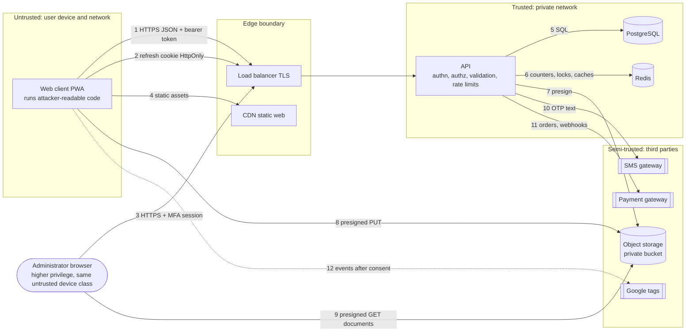

# Payana — Threat Model

*Version 1.0 · 2026-11-10 · method: data-flow decomposition + STRIDE + product-specific abuse cases*

This is a design-time model. It states what must be true for the system to
be safe; it does not certify that the implementation is. Verification is by
the tests named in each feature spec, the security review before release,
and an independent penetration test (NFR-SEC-012).

## 1. Assets

| # | Asset | Why it matters | Class |
| --- | --- | --- | --- |
| A1 | Identity documents and numbers of drivers (licence, ID, RC, insurance, permit) | Identity theft; legal exposure | Sensitive |
| A2 | Live position of drivers | Stalking, robbery, harassment | Sensitive |
| A3 | Customer phone numbers, names, pickup/drop places (incl. homes and stays), emergency contacts | Harassment, stalking, spam | Personal / sensitive |
| A4 | Sessions and credentials (refresh tokens, admin passwords, TOTP secrets, signing keys) | Account takeover | Sensitive |
| A5 | Administrative capability (verify, suspend, configure, create staff) | Total compromise of trust | Critical |
| A6 | The "Verified" signal and ratings | The product's trust currency | Integrity |
| A7 | Booking and quote integrity | Money and safety decisions depend on it | Integrity |
| A8 | Money: SMS budget, subscription/featured revenue, advertiser spend | Direct financial loss | Financial |
| A9 | Audit log | Accountability, investigation | Integrity |
| A10 | Availability of sign-in, search and acceptance | Core service | Availability |

## 2. Actors

| Actor | Capability assumed |
| --- | --- |
| Anonymous internet user / bot | Unlimited requests from many addresses; scripted clients |
| Malicious customer | Valid account; reads client code; replays and tampers requests |
| Malicious or fake driver | Valid account; forged documents; scripted quoting; colludes with accomplices |
| Competitor | Scrapes listings and prices; inflates ad clicks |
| Compromised or malicious staff member | Valid admin session with one role |
| Network attacker | Controls a Wi-Fi hotspot (café, hostel) |
| Thief of an unlocked phone | Physical access to an installed PWA |

## 3. Trust boundaries and data flows

| Boundary | What crosses | Control |
| --- | --- | --- |
| Device → edge (1, 2, 3) | Every request | TLS, HSTS; nothing from the client is trusted; server-side authz and validation |
| Edge → API | Terminated TLS | Private subnets; security groups; request size limits |
| API → data (5, 6) | Queries | Parameterised SQL only; least-privilege DB role; no direct access from outside |
| API ↔ storage (7, 8, 9) | Files | Private bucket; short-lived signed URLs bound to key, method, type and size |
| API → SMS / payments (10, 11) | Phone + code; order references | Secrets in the secret store; webhook signature verification; minimal data |
| Device → Google (12) | Events | Only after consent; no PII by construction (F-14) |

## 4. STRIDE by component

### 4.1 Web client

| Threat | Scenario | Mitigation | Req. |
| --- | --- | --- | --- |
| **S**poofing | Phishing page imitating sign-in | HSTS; no passwords for users (OTP); admin MFA; short OTP lifetime | FR-IAM-012, NFR-SEC-001 |
| **T**ampering | Modified client calls hidden actions or sends altered amounts | Server authorises every call; server derives all amounts; `allowedActions` are advisory | FR-IAM-010, FR-BKG-010 |
| **R**epudiation | "I never accepted that quote" | Accept is authenticated, idempotent, audited with request ID | FR-REQ-015, FR-ADM-010 |
| **I**nfo disclosure | XSS steals tokens or page data | Framework escaping; no `innerHTML` with user text; strict CSP; refresh token HttpOnly; access token in memory; no sensitive data in web storage or SW cache | NFR-SEC-005, FR-IAM-004, F-17 AC-06/11 |
| **I**nfo disclosure | Shared / stolen phone shows bookings | No personal API data in Cache Storage; sessions revocable remotely; admin sessions short | F-17 BR-02, FR-IAM-007 |
| **D**oS | Heavy animation or third-party script blocks the UI | Budgets; tags load after consent and paint; blocked scripts are tolerated | NFR-PERF-005, F-14 AC-20 |
| **E**oP | Navigating to `/admin` as a user | Route guards are courtesy; API returns 401/403; admin bundle holds no secrets | FR-ADM-009 |

### 4.2 API (authentication, sessions)

| Threat | Scenario | Mitigation | Req. |
| --- | --- | --- | --- |
| **S** | Guessing OTPs | 6 digits, 5 attempts per challenge, challenge expiry, lockout, per-IP limits | FR-IAM-003, -008 |
| **S** | Stolen refresh token replayed | Rotation + reuse detection revokes the session; audited; alert | FR-IAM-005 |
| **S** | Forged JWT (`alg: none`, key confusion) | Fixed algorithm allow-list; key by `kid`; short lifetime | F-01 NT-03 |
| **T** | CSRF on cookie endpoints | `SameSite=Strict`; `Origin` allow-list; JSON content type; only refresh/logout use the cookie | NFR-SEC-011 |
| **R** | Disputed sign-in or session revoke | Security events audited | FR-IAM-017 |
| **I** | Account enumeration by phone or admin email | Uniform responses and timing class for OTP request and admin login | F-01 AC-01, AC-16 |
| **D** | Credential-stuffing or OTP flood exhausts the service | Redis-backed limits; fail closed on auth when Redis is down; WAF recommended | NFR-SEC-007, NFR-REL-004 |
| **E** | Token carrying stale or forged permissions | Permissions derived per request from role; session revocation on role change | F-01 BR-11, F-16 AC-15 |

### 4.3 API (business modules)

| Threat | Scenario | Mitigation | Req. |
| --- | --- | --- | --- |
| **S** | Driver operates a vehicle they do not own | Ownership or `Active` authorisation checked on availability and on quoting | FR-PRT-011, FR-REQ-011 |
| **T** | Mass assignment (`verificationStatus`, `listingStatus`, `fare`, `roles` in a body) | Allow-list DTOs; unknown properties rejected; privileged fields have no client DTO | NFR-SEC-006 |
| **T** | Skipping booking states or racing two accepts | Server state machines; row lock on accept; optimistic versioning on transitions | FR-BKG-004, FR-REQ-015 |
| **R** | Driver denies cancelling | Immutable `booking_events` with actor | FR-BKG-013 |
| **I** | IDOR on bookings, requests, tickets, saved places, invoices | Owner/party filter in every query; foreign IDs return `404`; UUIDs | FR-IAM-010, F-08 AC-04 |
| **I** | Phone numbers or coordinates leaking through list/detail payloads | Serializers add phone only inside an active booking for the counter-party; discovery payloads have no coordinates; schema assertions in tests | FR-BKG-006, FR-DSC-005 |
| **D** | Expensive search or polling abuse | Radius cap, page-size cap, rate limits, GiST index, `ETag`/304 | NFR-PERF-002, NFR-SEC-007 |
| **E** | Customer calls driver/admin routes | Central role/permission guard; default deny; generated access-matrix test | NFR-SEC-002 |

### 4.4 Admin console

| Threat | Scenario | Mitigation | Req. |
| --- | --- | --- | --- |
| **S** | Admin account takeover | Password policy, lockout, mandatory TOTP, no SMS dependency, alerting; optional network allow-list | FR-IAM-011, -012 |
| **T** | Settings changed to inject script (analytics IDs) | Strict patterns on both sides; loader builds URLs from fixed origins | FR-ANL-009 |
| **R** | Staff deny an action | Every mutation and case view audited; audit append-only; only `super_admin` reads it | FR-ADM-010, NFR-SEC-010 |
| **I** | Bulk export of users or documents by an insider | Least privilege per role; search guards and rate limits; signed document URLs ≤ 5 min; case views audited | FR-IAM-013, F-05 §7 |
| **D** | Mis-set feature flag disables the product | Confirm step; audit; revert by data | F-16 BR-11 |
| **E** | Lower role escalates (creates staff, edits own role) | `staff.manage` only for `super_admin`; cannot change own role; last-super-admin guard | F-16 AC-14…16 |

### 4.5 Data stores and files

| Threat | Scenario | Mitigation | Req. |
| --- | --- | --- | --- |
| **T** | SQL injection | Parameterised queries; ORM; raw SQL only with bound parameters; review of every raw query | ADR-0002 |
| **I** | Database or backup exposure | Private subnets; encryption at rest; no public snapshot; secrets in the secret store; hashed tokens/OTPs; encrypted TOTP secrets | NFR-SEC-004 |
| **I** | Guessable or public document URLs | Private bucket; unguessable keys; signed, expiring access; never served from the web origin | NFR-SEC-008 |
| **T** | Malicious upload (script in an "image", oversized, wrong type) | Type allow-list, size cap, magic-byte check, download as attachment/inline viewer with `nosniff`; malware scan at R1.1 | NFR-SEC-008 |
| **R** | Audit tampering | Application role cannot update/delete; separate maintenance role | NFR-SEC-010 |
| **D** | Storage filled by uploads | Per-user daily cap; orphan purge; lifecycle rules | F-04 §7 |

### 4.6 Third-party integrations

| Threat | Scenario | Mitigation | Req. |
| --- | --- | --- | --- |
| **S** | Forged payment webhook marks an invoice paid | Signature verification; idempotent by provider event ID; amount cross-check (R1.1) | F-11 BR-10 |
| **I** | OTP or personal data in provider logs | Minimal payload; masked logging on our side; provider DPA (R1.1) | NFR-PRIV-005 |
| **I** | PII sent to Google | Route-template paths; parameter allow-list; PII scanner; nothing before consent | FR-ANL-008, NFR-PRIV-004 |
| **T** | Compromised third-party script | Only Google origins allowed by CSP; no GTM; nothing loaded when unconfigured | ADR-0014 |
| **D** | Provider outage | Ports with timeouts; OTP failure surfaces a clear retry; core reads unaffected | NFR-REL-004 |

### 4.7 Build and deployment

| Threat | Scenario | Mitigation | Req. |
| --- | --- | --- | --- |
| **T** | Malicious dependency or CI action | Lockfiles, `npm ci`, audit gate, actions pinned by SHA, minimal CI permissions, OIDC instead of static keys | NFR-SEC-009 |
| **I** | Secret committed or printed in logs | Secret scanning; config schema never logs values; `.env` git-ignored | NFR-SEC-003 |
| **E** | Development adapters reach production (OTP echo, free checkout) | Start-up guards keyed on environment; smoke test asserts `devCode` absent | F-01 AC-21, F-11 AC-19 |

## 5. Product-specific abuse cases

| # | Abuse case | How it works | Impact | Mitigations | Residual |
| --- | --- | --- | --- | --- | --- |
| **T-01** | **OTP pumping / SMS toll fraud** | Bots request OTPs for many (often premium-route or attacker-controlled) numbers to burn SMS budget or earn revenue share | Direct cost; SMS provider suspension | India-only number pattern; per-phone and per-IP limits; resend cooldown; global send-rate circuit breaker and alert (NFR-OBS-004); uniform responses; WAF/bot challenge recommended before launch | Distributed, low-rate attacks stay under limits — monitor cost per verified sign-in; add CAPTCHA/attestation if it rises |
| **T-02** | **Fake drivers / forged documents** | Uploading someone else's or edited documents to gain the Verified badge; listing a vehicle not controlled | Customer safety; brand trust | Human review of each document with number and expiry; rejection reasons incl. `suspected_forgery`; ownership vs. authorisation model; unique registration numbers; re-verification on change; expiry job; suspension | Skilled forgeries pass visual review — no government-registry check exists (D-14); "Verified" is worded narrowly |
| **T-03** | **Location stalking of drivers** | Repeated searches from chosen points to trilaterate a driver's position, or to learn their routine | Physical safety | No coordinates in any public payload; distance to 0.1 km, bearing to 10°, position snapped to a ~100 m grid before derivation; freshness cut-off; search rate limits; only last position stored | A determined observer can still infer an area of a few hundred metres for an available driver — inherent to "nearby" discovery; disclosed to drivers |
| **T-04** | **Phone-number harvesting** | Creating requests or quotes to obtain the other side's number, then cancelling; scraping lists | Spam, harassment, off-platform poaching | Phones only inside an active booking, only to the counter-party, removed afterwards; inbox shows first name only; masked numbers elsewhere; request/quote limits; cancellation rates tracked | A party who completes acceptance does get one number per booking — bounded by request limits and by accounts being suspendable |
| **T-05** | **Quote spam and bait pricing** | Flooding every request with quotes; quoting unrealistically low then renegotiating or cancelling | Poor marketplace quality | One active quote per driver per request; plan quote limits; fare sanity bounds; driver cancellation rate public on profile; withdrawals audited; reviews | Bait-and-renegotiate at pickup is off-platform behaviour — handled by reviews, disputes and suspension |
| **T-06** | **Review fraud** | Self-booking with a second account to post 5-star reviews; revenge reviews | Corrupts ratings | Review requires a completed booking between distinct accounts; one per booking; window; moderation; signals logged (same device family, instant completions) | Collusion with real second phones is possible; detection tooling is P2 |
| **T-07** | **Ad-click fraud** | Inflating impressions/clicks to cheat an advertiser or exhaust a competitor's campaign | Advertiser trust | Anonymous but rate-limited events; counted only for running campaigns; bot filtering; CTR anomaly alert; advertisers billed by period, not per click, at R1 | Low-rate distributed inflation is not detectable at R1 — acceptable while billing is flat |
| **T-08** | **Admin account takeover** | Phishing, password reuse, stolen laptop session | Full compromise (documents, suspension, configuration) | Mandatory TOTP; Argon2id; lockout; 10-min access tokens and 12-h sessions; least privilege; staff changes revoke sessions; audit + alerts; ≥ 2 super admins | Real-time phishing of TOTP codes remains possible — passkeys are the planned improvement (ADR-0004) |
| **T-09** | **Insider misuse** | Staff browsing documents or users without need | Privacy breach | Role scoping; case views audited; short-lived document URLs; search guards; audit readable only by `super_admin` | Audit is detective, not preventive |
| **T-10** | **IDOR on bookings and requests** | Changing an ID in a URL to read or act on another user's booking, request, ticket or invoice | Privacy breach; fraud | Party/owner predicate in every query; `404` on foreign IDs; UUIDs; generated negative tests per route | Depends on every new endpoint following the pattern — enforced by the access-matrix test and review |
| **T-11** | **Request spam / denial of marketplace** | Flooding drivers with fake requests | Drivers ignore the app | `MAX_OPEN_REQUESTS_PER_CUSTOMER`; create rate limit; duplicate guard; OTP-verified accounts; suspension | A patient attacker with many SIMs can still create noise |
| **T-12** | **Free-text abuse** | Phone numbers, links or abuse in notes, reviews, ticket messages | Off-platform contact; harassment | Length limits; escaping; phone-pattern masking in request notes; moderation; reports | Obfuscated contact details pass |
| **T-13** | **Authorisation invite abuse** | Owner invites arbitrary phone numbers to harass or to probe which numbers have accounts | Nuisance; enumeration | Masked phone in responses; identical response whether or not the phone has an account; rate limit on invites; invitee can decline | — |
| **T-14** | **Consent bypass** | Tags firing before consent through a coding error | Regulatory exposure | Loader is the only code that can request Google origins; e2e test asserts zero requests pre-consent; CSP limits origins | Regressions are caught only if the e2e test stays in the gate |

## 6. Mitigation coverage by requirement

| Control | Requirements | Verified by |
| --- | --- | --- |
| Server-side authorisation, default deny | FR-IAM-010, FR-ADM-009, NFR-SEC-002 | Generated access-matrix integration test (F-01 IT-06, F-16 IT-01) |
| OTP abuse controls | FR-IAM-003, -008, NFR-SEC-007 | F-01 IT-04 |
| Token rotation and reuse detection | FR-IAM-004…006 | F-01 IT-03 |
| Admin MFA and least privilege | FR-IAM-011…013 | F-01 IT-05, F-16 NT-02 |
| Location privacy | FR-DSC-005, NFR-PRIV-002 | F-06 IT-03 |
| Contact privacy | FR-BKG-006, FR-PRT-015, FR-REQ-009 | F-08 IT-02, F-07 IT-05 |
| Document confidentiality | FR-PRT-004, FR-VER-002, NFR-SEC-008 | F-04 IT-02, F-05 IT-02 |
| Booking integrity under concurrency | FR-REQ-015, FR-BKG-004, NFR-REL-003 | F-07 IT-07, F-08 IT-04 |
| Audit integrity | FR-ADM-010, FR-OPS-016, NFR-SEC-010 | F-16 IT-05/06, F-18 IT-07 |
| Consent-gated measurement, no PII | FR-ANL-004, -005, -008, NFR-PRIV-004 | F-14 E2E-01…04, UT-05 |
| Input validation | FR-OPS-004, NFR-SEC-006 | Negative tests in every feature |
| Secrets and supply chain | FR-OPS-012, NFR-SEC-003, -009 | CI gates |
| Development adapters blocked in production | F-01 AC-21, F-11 AC-19, F-15 AC-12 | Start-up tests |

## 7. Residual risks accepted for R1

| # | Risk | Why accepted | Revisit |
| --- | --- | --- | --- |
| RR-1 | No government-registry or background verification of drivers | No integration available to the operator; cost; D-14 | Before scaling beyond the pilot |
| RR-2 | No malware scanning of uploaded documents | Files are viewed only by staff in a browser; scan planned | R1.1 |
| RR-3 | No WAF / bot management in the Terraform definition | Recommended, not built | Before public launch |
| RR-4 | Anonymous consent is not provable server-side | Device-only storage | With legal review (D-03) |
| RR-5 | Admin recovery relies on a second `super_admin`; no change-password operation | Contract gap (F-01 G-1) | R1.1 |
| RR-6 | Fraud detection for reviews, ads and requests is rule-based and manual | Volume is low at launch | When volume grows |
| RR-7 | Driver position can be inferred to a few hundred metres | Inherent to nearby discovery | — |
| RR-8 | Document numbers stored unencrypted at column level | Database-level encryption only | Security review |
| RR-9 | No emergency / SOS workflow despite a tourist-transport context | Out of R1 scope (D-15) | Owner decision |

## 8. Security review checklist (gate before release)

1. Access-matrix test covers 100 % of routes and passes.
2. No route without an access declaration (start-up check).
3. Dependency audit clean at high/critical; secret scan clean.
4. CSP enforced (after report-only period) with no `unsafe-eval` and no
   wildcard script source.
5. Cookies: `HttpOnly`, `Secure`, `SameSite=Strict`, correct path and domain.
6. Production configuration rejects development adapters; `devCode` absent.
7. Bucket policy: public access blocked; signed URL lifetimes as specified.
8. Database role privileges: no `UPDATE`/`DELETE` on `audit_logs`.
9. Logs sampled for PII (phone, email, coordinates, tokens) — none found.
10. Penetration test completed; high/critical findings closed (NFR-SEC-012).
11. Two `super_admin` accounts enrolled in MFA; seed password rotated.
12. Privacy notice and consent wording reviewed by counsel (D-03).
